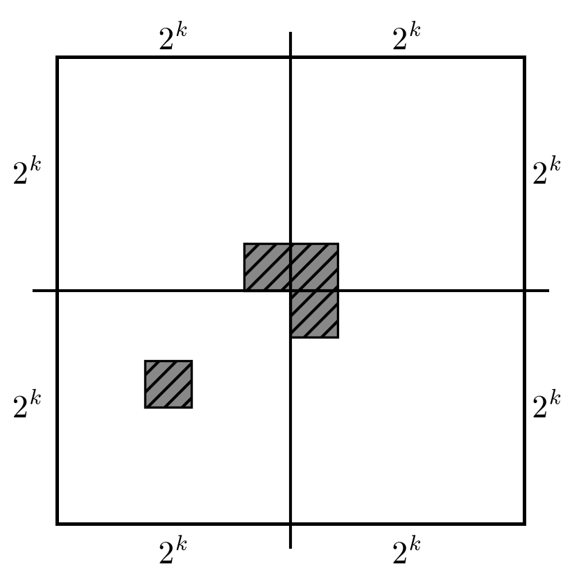

# 1. Математикийн индукцийн нэгдүгээр хэлбэр

Математикийн индукц нь эерэг бүхэл тоо $n$-ийг агуулсан өгөгдсөн $P(n)$ өгүүлбэрийг батлахад ашигладаг түгээмэл баталгааны арга юм. Энэ нь дараах индукцийн аксиомын шууд мөрдөлгөө болно.

::: {.callout-important icon=false title="Индукцийн аксиом"}
$S$ нь эерэг бүхэл тооны $\mathbf{N}^*$ олонлогийн дэд олонлог бөгөөд дараах хоёр нөхцөлийг хангадаг байг:

1. $1 \in S$;
2. Хэрэв $n \in S$ бол $n + 1 \in S$ байна.

Тэгвэл $S = \mathbf{N}^*$ байна.
:::

Индукцийн аксиом нь Пеаногийн эерэг бүхэл тооны таван аксиомын нэг бөгөөд математикийн индукцийн үндэс суурийг тавьсан юм.

Математикийн индукцийн нэгдүгээр хэлбэр нь ахлах сургуулийн сурах бичгүүдэд дурдагддаг хамгийн түгээмэл хэлбэр юм.

::: {.callout-tip icon=false title="Математикийн индукцийн нэгдүгээр хэлбэр"}
$P(n)$ нь эерэг бүхэл тоо $n$-ийн тухай өгүүлбэр (эсвэл шинж чанар) байг. Дараах нөхцөлүүд биелдэг гэж үзье:

1. $n = 1$ үед $P(n)$ үнэн;
2. $P(n)$ үнэн гэдгээс $P(n + 1)$ үнэн гэдэг нь мөрдөн гардаг.

Тэгвэл бүх $n \in \mathbf{N}^*$ хувьд $P(n)$ үнэн байна.
:::

**Баталгаа.** $S = \{n \mid n \in \mathbf{N}^* \text{ ба } P(n) \text{ үнэн}\}$ гэж тэмдэглэе. Тэгвэл $S$ нь $\mathbf{N}^*$-ийн дэд олонлог болно. (1)-ийг ажиглавал $1 \in S$; (2)-ыг ажиглавал хэрэв $n \in S$ бол $n + 1 \in S$ болно. Иймд индукцийн аксиом ёсоор $S = \mathbf{N}^*$, өөрөөр хэлбэл бүх $n \in \mathbf{N}^*$ хувьд $P(n)$ үнэн гэж дүгнэж болно.

**Тайлбар.** Үнэн хэрэгтээ математикийн индукцийн нэгдүгээр хэлбэр нь индукцийн аксиомтой эквивалент юм. Тиймээс тэдгээрийг мөн математикийн индукцийн зарчим гэж нэрлэдэг. Математикийн индукцийн нэгдүгээр хэлбэрийг товчоор математикийн индукц гэнэ.

Ахлах ангийн сурагчдын хувьд математикийн индукцийн утга санаа, үнэн зөвийг ойлгоход тийм ч хэцүү биш. Гэсэн хэдий ч математикийн индукцийг бодлогод хэрэглэх нь амаргүй ажил юм.

Математикийн индукцийг ашиглах нь хоёр алхмаас бүрдэнэ. $P(1)$ үнэн эсэхийг шалгах нь суурь нөхцөлийг тавина. Индукцийн таамаглалыг холбогдох мэдлэгтэй хослуулан $P(n+1)$-ийн рекуррент хамаарлыг гаргаж авна. Эдгээр хоёр алхам нь өгүүлбэрийг батлахад бие биеэ нөхөж, индуктив баталгааны логик бүтцийг бүрдүүлдэг. Хамгийн чухал нь индуктив баталгаанд индукцийн таамаглалыг заавал ашиглах ёстой бөгөөд энэ нь баталгааны зөв эсэхийг шалгах шалгуур болдог.

::: {.callout-note icon=false title="Жишээ 1"}
Аливаа $n \in \mathbf{N}^*$ хувьд дараах тэнцэтгэл биелэхийг батал:
$$\frac{1}{1 \times 2} + \frac{1}{2 \times 3} + \dots + \frac{1}{n(n+1)} = 1 - \frac{1}{n+1}. \tag{1}$$
:::

**Баталгаа.** $n = 1$ үед $(1)$-ийн зүүн тал $= \frac{1}{2}$, харин баруун тал $= 1 - \frac{1}{1+1} = \frac{1}{2}$ байна. Иймд $n = 1$ үед $(1)$ биелнэ.

Одоо $n$ үед $(1)$ биелнэ гэж таамаглая. $n + 1$ тохиолдлыг авч үзье. $\frac{1}{k(k+1)} = \frac{1}{k} - \frac{1}{k+1}$ гэдгийг ашиглавал бидэнд:
$$\begin{aligned}
\frac{1}{1 \times 2} + \frac{1}{2 \times 3} + \dots + \frac{1}{(n+1)(n+2)} &= \left(1 - \frac{1}{2}\right) + \left(\frac{1}{2} - \frac{1}{3}\right) + \dots + \left(\frac{1}{n+1} - \frac{1}{n+2}\right) \\
&= 1 - \frac{1}{n+2}. \tag{2}
\end{aligned}$$

Тиймээс $(1)$ тэнцэтгэл $n + 1$ үед биелнэ.  
Дүгнэж хэлбэл, математикийн индукцийн зарчим ёсоор $(1)$ тэнцэтгэл бүх эерэг бүхэл $n$-ийн хувьд биелэхийг баталлаа.

**Тайлбар.** Энэхүү баталгаа нь $n + 1$ үед $(1)$ биелэхийг батлахдаа индукцийн таамаглалыг ашиглаагүй тул буруу юм.  
Зөв бодолт нь дараах байдалтай байна:  
Индукцийн таамаглалыг ашиглавал бидэнд:
$$\begin{aligned}
&\frac{1}{1 \times 2} + \frac{1}{2 \times 3} + \dots + \frac{1}{n(n+1)} + \frac{1}{(n+1)(n+2)} \\
&= \left(1 - \frac{1}{n+1}\right) + \frac{1}{(n+1)(n+2)} \\
&= \left(1 - \frac{1}{n+1}\right) + \left(\frac{1}{n+1} - \frac{1}{n+2}\right) \\
&= 1 - \frac{1}{n+2}.
\end{aligned}$$
Тиймээс $(1)$ нь $n + 1$ үед биелнэ.  
Үнэн хэрэгтээ $(2)$ тэнцэтгэл зөв гарсан хэдий ч энэ нь математикийн индукцийн аргыг ашиглаагүй шууд баталгаа болсон юм. Ахлах ангийн сурагчид энэ алдааг түгээмэл гаргадаг тул үүнийг нухацтай засаж залруулах шаардлагатай. Эс тэгвээс сурагчдад дедукцийн зөв сэтгэлгээний бүтэц төлөвшихөд бэрхшээлтэй болно.

---

::: {.callout-note icon=false title="Жишээ 2"}
$n \in \mathbf{N}^*$ байг. $2^n \times 2^n$ хэмжээтэй торноос дурын нэг нүдийг хасахад үлдсэн хэсгийг L хэлбэрийн гурван нүдтэй хавтангаар (завсаргүй, давхцуулахгүйгээр) бүрэн бүрж болохыг батал.
:::

**Баталгаа.** $n = 1$ үед $2 \times 2$ хэмжээтэй торноос дурын нэг нүдийг хасахад яг L хэлбэрийн гурван нүдтэй хавтан үүснэ. Иймд өгүүлбэр $n = 1$ үед үнэн.

Одоо $n = k$ үед өгүүлбэр үнэн гэж таамаглая. Өөрөөр хэлбэл, $2^k \times 2^k$ торноос дурын нэг нүдийг хасахад үлдсэн хэсгийг L хэлбэрийн хавтангаар бүрж чадна. $n = k + 1$ тохиолдлыг авч үзье.

{fig-align="center" width="220px"}

Зураг 1-д харуулсны дагуу $2^{k+1} \times 2^{k+1}$ торыг дундуур нь босоо, хэвтээ шулуунаар дөрвөн тэнцүү $2^k \times 2^k$ тор болгон хуваахад хасагдсан нүд эдгээр дөрвөн $2^k \times 2^k$ торны аль нэгэнд орно. Иймд эхлээд үлдсэн гурван торны уулзвар төв хэсэгт нэг L хэлбэрийн хавтан (зураг дээрх сүүдэрлэсэн гурван нүд) байрлуулъя. Тэгвэл одоо $2^k \times 2^k$ хэмжээтэй дөрвөн тор тус бүрээс яг нэг нэг нүд хасагдсан болно. Индукцийн таамаглал ёсоор эдгээр дөрвөн торыг тус бүрд нь L хэлбэрийн хавтангаар бүрж чадна. Төвд тавьсан хавтантай нийлээд $n = k + 1$ үед өгүүлбэр үнэн болох нь батлагдана.

Дээрхийг нэгтгэн дүгнэвэл, өгүүлбэр бүх эерэг бүхэл $n$-ийн хувьд үнэн.

**Тайлбар.** Энэхүү жишээ нь математикийн индукцийн баталгааны нийтлэг хэлбэрийг харуулж байна. Бичлэгийн бүтэц нь хүн бүрийн арга барилаас хамааран өөр байж болох ч индукцийн таамаглалаас дүгнэлт рүү зөв шилжих нь индукцээр батлах гол алхам юм.

---

::: {.callout-note icon=false title="Жишээ 3"}
$x, y$ бодит тоонуудын хувьд $x + y$, $x^2 + y^2$, $x^3 + y^3$ ба $x^4 + y^4$ нь бүгд бүхэл тоонууд байг. Аливаа $n \in \mathbf{N}^*$ хувьд $x^n + y^n$ бүхэл тоо болохыг батал.
:::

**Баталгаа.** Энэ бодлого нь математикийн индукцийн өөрчилсөн хэлбэрийг шаардана: эерэг бүхэл тоо $n$-ийн тухай өгүүлбэрийг $P(n)$ гэе. Хэрэв:
1. $n = 1$ ба $n = 2$ үед $P(n)$ үнэн;
2. $P(n)$ ба $P(n + 1)$ үнэн гэдгээс $P(n + 2)$ үнэн гэдэг нь мөрдөн гардаг

бол бүх $n \in \mathbf{N}^*$ хувьд $P(n)$ үнэн байна. Үнэн хэрэгтээ энэ өөрчлөлт нь индукцийн алхмын хэмжээг л тохируулж буй хэрэг бөгөөд ийм тохиолдол цаашдын хэлэлцүүлэгт олонтоо тааралдана.

Бодлогодоо эргэн оръё. $x + y$ ба $x^2 + y^2$ хоёулаа бүхэл тоо тул өгүүлбэр $n = 1$ ба $n = 2$ үед үнэн.  
$n$ ба $n + 1$ үед өгүүлбэр үнэн, өөрөөр хэлбэл $x^n + y^n$ ба $x^{n+1} + y^{n+1}$ хоёулаа бүхэл тоо гэж таамаглая. $n + 2$ тохиолдлыг авч үзвэл:
$$x^{n+2} + y^{n+2} = (x + y)(x^{n+1} + y^{n+1}) - xy(x^n + y^n).$$
Иймд индукцийн таамаглал болон $x + y \in \mathbf{Z}$ нөхцөлийг ашиглавал $x^{n+2} + y^{n+2} \in \mathbf{Z}$ гэдгийг батлахын тулд зөвхөн $xy \in \mathbf{Z}$ гэдгийг батлахад хангалттай.

$x + y, x^2 + y^2 \in \mathbf{Z}$ гэдгийг ашиглавал:
$$2xy = (x + y)^2 - (x^2 + y^2) \in \mathbf{Z}.$$
Хэрэв $xy \notin \mathbf{Z}$ бол $xy = \frac{m}{2}$ ($m$ нь сондгой бүхэл тоо) гэе. $x^2 + y^2, x^4 + y^4 \in \mathbf{Z}$ тул:
$$2x^2 y^2 = (x^2 + y^2)^2 - (x^4 + y^4) \in \mathbf{Z}$$
болно. Тиймээс $2 \times \left(\frac{m}{2}\right)^2 = \frac{m^2}{2} \in \mathbf{Z}$ болж, $m$ сондгой гэдэгтэй зөрчилдөнө. Иймд $xy \in \mathbf{Z}$ тул $n + 2$ үед өгүүлбэр үнэн.  
Дүгнэж хэлбэл, бүх $n \in \mathbf{N}^*$ хувьд $x^n + y^n \in \mathbf{Z}$ байна.

---

::: {.callout-note icon=false title="Жишээ 4"}
$\theta \in \left(0, \frac{\pi}{2}\right)$ ба $n$ нь $1$-ээс их эерэг бүхэл тоо байг. Дараах тэнцэтгэл биш биелэхийг батал:
$$\left(\frac{1}{\sin^n \theta} - 1\right)\left(\frac{1}{\cos^n \theta} - 1\right) \geqslant 2^n - 2^{\frac{n}{2} + 1} + 1. \tag{1}$$
:::

**Баталгаа.** $n = 2$ үед $(1)$-ийн зүүн ба баруун талууд тэнцүү тул $n = 2$ үед өгүүлбэр үнэн.  
$n$ ($n \geqslant 2$) үед өгүүлбэр үнэн гэж таамаглая. Тэгвэл:
$$\begin{aligned}
&\left(\frac{1}{\sin^{n+1} \theta} - 1\right)\left(\frac{1}{\cos^{n+1} \theta} - 1\right) \\
&= \frac{1}{\sin^{n+1}\theta \cos^{n+1}\theta} (1 - \sin^{n+1}\theta)(1 - \cos^{n+1}\theta) \\
&= \frac{1}{\sin^{n+1}\theta \cos^{n+1}\theta} (1 - \sin^{n+1}\theta - \cos^{n+1}\theta) + 1 \\
&= \frac{1}{\sin\theta \cos\theta} \left(\frac{1}{\sin^n\theta \cos^n\theta} - \frac{\cos\theta}{\sin^n\theta} - \frac{\sin\theta}{\cos^n\theta}\right) + 1 \\
&= \frac{1}{\sin\theta \cos\theta} \left[\left(\frac{1}{\sin^n\theta} - 1\right)\left(\frac{1}{\cos^n\theta} - 1\right) + \frac{1 - \cos\theta}{\sin^n\theta} + \frac{1 - \sin\theta}{\cos^n\theta} - 1\right] + 1 \\
&\geqslant \frac{1}{\sin\theta \cos\theta} \left[\left(2^n - 2^{\frac{n}{2} + 1}\right) + 2\sqrt{\frac{(1 - \cos\theta)(1 - \sin\theta)}{\sin^n\theta \cos^n\theta}}\right] + 1, \tag{2}
\end{aligned}$$
энд $(2)$ нь индукцийн таамаглал болон Кошийн (AM-GM) тэнцэтгэл бишээс гарна.

$\sin\theta \cos\theta = \frac{1}{2}\sin 2\theta \leqslant \frac{1}{2}$ болохыг болон
$$\frac{(1 - \cos\theta)(1 - \sin\theta)}{\sin^n\theta \cos^n\theta} = \left(\frac{1}{\sin\theta \cos\theta}\right)^{n-2} \cdot \frac{1}{(1 + \sin\theta)(1 + \cos\theta)}$$
гэдгийг ажиглая. Энд $t = \sin\theta + \cos\theta = \sqrt{2}\sin\left(\theta + \frac{\pi}{4}\right) \in (1, \sqrt{2}]$ чанарыг ашиглавал:
$$\begin{aligned}
(1 + \sin\theta)(1 + \cos\theta) &= 1 + \sin\theta + \cos\theta + \sin\theta \cos\theta \\
&= 1 + t + \frac{t^2 - 1}{2} \\
&= \frac{1}{2}(t + 1)^2 \leqslant \frac{1}{2}(\sqrt{2} + 1)^2.
\end{aligned}$$
Иймд:
$$\sqrt{\frac{(1 - \cos\theta)(1 - \sin\theta)}{\sin^n\theta \cos^n\theta}} \geqslant \frac{2^{\frac{n-1}{2}}}{\sqrt{2} + 1} = 2^{\frac{n}{2}} - 2^{\frac{n-1}{2}}.$$
Тиймээс $(2)$-оос дараах тэнцэтгэл биш мөрдөн гарна:
$$\begin{aligned}
\left(\frac{1}{\sin^{n+1}\theta} - 1\right)\left(\frac{1}{\cos^{n+1}\theta} - 1\right) &\geqslant 2\left[\left(2^n - 2^{\frac{n}{2} + 1}\right) + 2\left(2^{\frac{n}{2}} - 2^{\frac{n-1}{2}}\right)\right] + 1 \\
&= 2\left(2^n - 2^{\frac{n+1}{2}}\right) + 1 = 2^{n+1} - 2^{\frac{n+1}{2} + 1} + 1.
\end{aligned}$$
Иймд өгүүлбэр $n + 1$ үед үнэн.  
Дүгнэж хэлбэл, өгүүлбэр бүх $n \in \mathbf{N}^*$ ($n \geqslant 2$) хувьд үнэн.

**Тайлбар.** Дээрх жишээнүүд нь алгебр, тооны онолоос эхлээд комбинаторик хүртэлх олон салбарын мэдлэгийг хамарч, математикийн индукцийн олон талт хэрэглээг харуулж байна.

---

::: {.callout-note icon=false title="Жишээ 5"}
$\{a_n\}$ дараалал дараах байдлаар тодорхойлогдов:
$$a_1 = 1, \quad a_n = a_{n-1} + a_{\lfloor \frac{n}{2} \rfloor}, \quad n = 2, 3, \dots$$
Энэ дараалалд $7$-д хуваагддаг төгсгөлгүй олон гишүүн оршино гэдгийг батал.
:::

**Баталгаа.** Рекуррент томьёогоор шууд тооцоолбол:
$$a_1 = 1, \quad a_2 = 2, \quad a_3 = 3, \quad a_4 = 5, \quad a_5 = 7.$$
Одоо $a_n$ ($n \geqslant 5$) нь $7$-д хуваагддаг гэж таамаглая. $7 \mid a_m$ нөхцөлийг хангах $m > n$ дугаарыг олъё.

$a_n \equiv 0 \pmod{7}$ тул $a_{2n} = a_{2n-1} + a_n \equiv a_{2n-1} \pmod{7}$ ба $a_{2n+1} = a_{2n} + a_n \equiv a_{2n} \pmod{7}$ байна. Иймд $a_{2n-1} \equiv a_{2n} \equiv a_{2n+1} \pmod{7}$ болно. $a_{2n-1}$-ийг $7$-д хуваахад гарах үлдэгдлийг $r$ гэе. Хэрэв $r = 0$ бол $m = 2n - 1$ гэж авахад хангалттай; хэрэв $r \neq 0$ бол дараах $7$ тоог авч үзье:
$$a_{4n-3}, a_{4n-2}, \dots, a_{4n+3}. \tag{1}$$
Дараах жишүүлгүүдийг ажиглавал:
$$\begin{aligned}
a_{4n-2} &= a_{4n-3} + a_{2n-1} \equiv a_{4n-3} + r \pmod{7}, \\
a_{4n-1} &= a_{4n-2} + a_{2n-1} \equiv a_{4n-2} + r \equiv a_{4n-3} + 2r \pmod{7}, \\
a_{4n} &= a_{4n-1} + a_{2n} \equiv a_{4n-1} + r \equiv a_{4n-3} + 3r \pmod{7}, \\
&\dots \\
a_{4n+3} &= a_{4n+2} + a_{2n+1} \equiv a_{4n+2} + r \equiv a_{4n-3} + 6r \pmod{7}.
\end{aligned}$$
Тиймээс $a_{4n-3}, a_{4n-2}, \dots, a_{4n+3}$ тоонууд нь $7$-гийн модулиар үлдэгдлийн бүрэн систем үүсгэнэ. Иймд $a_m \equiv 0 \pmod{7}$ нөхцөлийг хангах $m \in \{4n - 3, 4n - 2, \dots, 4n + 3\}$ оршино.  
Ийнхүү $a_5$-аас эхлэн дээрх гаргалгааг давтан хэрэглэснээр дараалалд $7$-д хуваагддаг төгсгөлгүй олон гишүүн оршино гэдгийг баталлаа.

---

::: {.callout-note icon=false title="Жишээ 6"}
1. Аливаа эерэг бүхэл $n$ ($n \geqslant 2$) тооны хувьд дурын $1 \leqslant i < j \leqslant n$ үед
   $$(a_i - a_j) \mid (a_i + a_j)$$
   нөхцөлийг хангах ялгаатай $n$ ширхэг эерэг бүхэл $a_1, \dots, a_n$ тоо оршихыг батал.
2. Дурын $i \neq j$ үед $(a_i - a_j) \mid (a_i + a_j)$ нөхцөлийг хангах эерэг бүхэл тооны төгсгөлгүй $\{a_1, a_2, \dots\}$ олонлог орших уу?
:::

**Баталгаа.**  
**(1)** $n = 2$ үед $1$ ба $2$ гэсэн тоонуудыг авахад хангалттай.  
$n$ үед өгүүлбэр үнэн гэж таамаглая. Өөрөөр хэлбэл, дурын $1 \leqslant i < j \leqslant n$ хувьд $(a_i - a_j) \mid (a_i + a_j)$ нөхцөлийг хангах $a_1  < a_2 < \dots < a_n$ эерэг бүхэл тоонууд оршино. Одоо дараах $n + 1$ тоог авч үзье:
$$A, \quad A + a_1, \quad A + a_2, \quad \dots, \quad A + a_n, \tag{1}$$
энд $A = a_n!$ ба $a_n! = 1 \times 2 \times 3 \times \dots \times a_n$.

$(1)$-ээс дурын хоёр $x < y$ тоог сонгож авъя.  
- Хэрэв $x = A$, $y = A + a_i$ ($1 \leqslant i \leqslant n$) бол $y - x = a_i$ ба $x + y = 2A + a_i$ болно. $a_i \leqslant a_n$ тул $a_i \mid A$, иймд $(y - x) \mid (y + x)$.  
- Хэрэв $x = A + a_i$, $y = A + a_j$ ($1 \leqslant i < j \leqslant n$) бол $y - x = a_j - a_i$, $y + x = 2A + (a_i + a_j)$ болно. Индукцийн таамаглал ёсоор $(a_j - a_i) \mid (a_j + a_i)$ ба $a_j - a_i < a_n$ тул $(a_j - a_i) \mid A$ болно. Тиймээс $(y - x) \mid (y + x)$.  

Ийнхүү өгүүлбэр $n + 1$ үед үнэн. Дүгнэж хэлбэл, аливаа $n \in \mathbf{N}^*$ ($n \geqslant 2$) хувьд нөхцөлийг хангах $n$ ширхэг эерэг бүхэл тоо оршино.

**(2)** Хэрэв дурын $1 \leqslant i < j$ хувьд $(a_i - a_j) \mid (a_i + a_j)$ нөхцөлийг хангах төгсгөлгүй олон эерэг бүхэл $a_1 < a_2 < \dots$ тоо оршдог бол аливаа $j > 1$ хувьд $(a_j - a_1) \mid (a_j + a_1)$ байна. Эндээс $(a_j - a_1) \mid 2a_1$ болно. Гэвч $a_1 < a_2 < \dots$ тул $2a_1$ тоо төгсгөлгүй олон эерэг бүхэл тоонд хуваагддаг болж зөрчил үүснэ. Тиймээс нөхцөлийг хангах төгсгөлгүй олон эерэг бүхэл тоо оршихгүй.

**Тайлбар.** Математикийн индукцийн баталдаг зүйл бол аливаа $n \in \mathbf{N}^*$ хувьд $P(n)$ үнэн гэдэг өгүүлбэр юм. Өөрөөр хэлбэл, энэ нь $P(\infty)$-ийн тухай бус, харин аливаа төгсгөлөг эерэг бүхэл $n$ тооны тухай өгүүлбэрүүдийг авч үздэг. Энэ жишээний (1) ба (2)-ыг харьцуулснаар төгсгөлөг ба төгсгөлгүй хоёрын үндсэн ялгааг харууллаа.  
Мэдээж бид Жишээ 5 дээр хийсэн шиг төгсгөлгүйтэй холбоотой зарим үр дүнг математикийн индукцээр баталж чадна. Жишээ 5 ба Жишээ 6-ийн рекуррент бүтцийг харьцуулбал эхнийх нь өмнөх үр дүнтэйгээ нийцтэй байдаг бол сүүлийнх нь тийм биш гэдгийг харж болно.