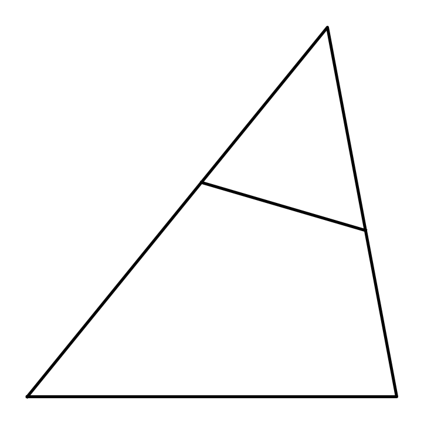
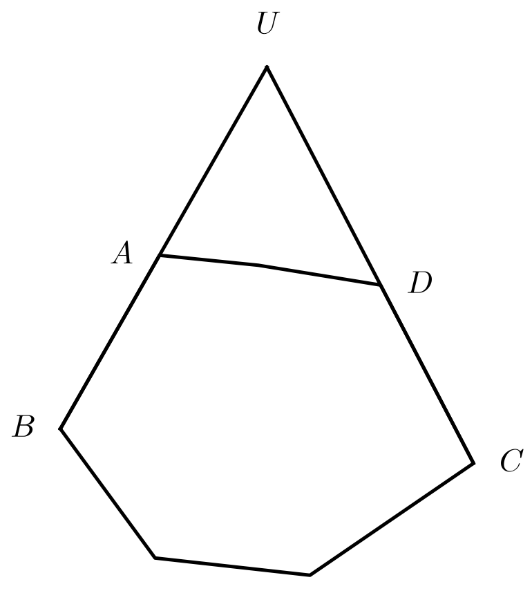

# 2. Математикийн индукцийн хоёрдугаар хэлбэр

::: {.callout-tip icon=false title="Математикийн индукцийн хоёрдугаар хэлбэр"}
$P(n)$ нь эерэг бүхэл тоо $n$-ийн тухай өгүүлбэр (эсвэл шинж чанар) байг. Дараах нөхцөлүүд биелдэг гэж үзье:

1. $n = 1$ үед $P(n)$ үнэн;
2. $n$-ээс бага бүх эерэг бүхэл $k$ тооны хувьд $P(k)$ үнэн гэдгээс $P(n)$ үнэн гэдэг нь мөрдөн гардаг.

Тэгвэл бүх $n \in \mathbf{N}^*$ хувьд $P(n)$ үнэн байна.
:::

**Баталгаа.** $Q(n)$: «$1 \leqslant k \leqslant n$ ($k \in \mathbf{N}^*$) байх бүх $k$-ийн хувьд $P(k)$ үнэн» гэсэн өгүүлбэрийг авч үзье. $Q(n)$ үнэн гэдгээс $P(n)$ үнэн гэдэг нь илэрхий мөрдөн гарна.  
$n = 1$ үед $(1)$ ёсоор $Q(1)$ үнэн.  
Одоо $Q(n - 1)$ ($n \geqslant 2$) үнэн гэж таамаглая. Өөрөөр хэлбэл, $1 \leqslant k \leqslant n - 1$ байх бүх $k$-ийн хувьд $P(k)$ үнэн. Тэгвэл $(2)$ ёсоор $P(n)$ үнэн болно. Иймд $1 \leqslant k \leqslant n$ ($k \in \mathbf{N}^*$) байх бүх $k$-ийн хувьд $P(k)$ үнэн болох тул $Q(n)$ үнэн байна.  
Эндээс математикийн индукцийн нэгдүгээр хэлбэр ёсоор бүх $n \in \mathbf{N}^*$ хувьд $Q(n)$ үнэн, улмаар $P(n)$ үнэн гэж дүгнэж болно. Ийнхүү математикийн индукцийн хоёрдугаар хэлбэр үнэн болохыг баталлаа.

Математикийн индукцийн хоёрдугаар хэлбэр нь нэгдүгээр хэлбэрийн мөрдөлгөө юм. Индукцийн таамаглал дэвшүүлэхдээ бид $P(1), \dots, P(n - 1)$ нь бүгд үнэн гэж үздэг. Улмаар эдгээр нөхцөлийн дор $P(n)$ үнэн болохыг батална. Энэ нь хоёрдугаар хэлбэрийн нэгдүгээр хэлбэрээс ялгарах онцлог бөгөөд зарим өгүүлбэрийг батлахад туйлын тохиромжтой байдаг.

---

::: {.callout-note icon=false title="Жишээ 1"}
Бодит тоон $a_1, a_2, \dots$ дараалал нь бүх $i, j \in \mathbf{N}^*$ хувьд $a_{i+j} \leqslant a_i + a_j$ нөхцөлийг хангадаг байг. Аливаа $n \in \mathbf{N}^*$ хувьд дараах тэнцэтгэл биш биелэхийг батал:
$$a_1 + \frac{a_2}{2} + \frac{a_3}{3} + \dots + \frac{a_n}{n} \geqslant a_n. \tag{1}$$
:::

**Баталгаа.** $n = 1$ үед өгүүлбэр үнэн болох нь илэрхий.  
Одоо $n$-ээс бага бүх эерэг бүхэл тооны хувьд $(1)$ биелнэ гэж таамаглая. Өөрөөр хэлбэл, $1 \leqslant k \leqslant n - 1$ хувьд:
$$a_1 + \frac{a_2}{2} + \dots + \frac{a_k}{k} \geqslant a_k.$$
$k = 1, 2, \dots, n - 1$ хувьд $b_k = a_1 + \frac{a_2}{2} + \dots + \frac{a_k}{k}$ гэж тэмдэглэе. Таамаглал ёсоор $\sum_{k=1}^{n-1} b_k \geqslant \sum_{k=1}^{n-1} a_k$, өөрөөр бичвэл:
$$(n - 1)a_1 + \frac{n - 2}{2}a_2 + \dots + \frac{n - (n - 1)}{n - 1}a_{n-1} \geqslant \sum_{k=1}^{n-1} a_k.$$
Хоёр тал дээр $\sum_{k=1}^{n-1} a_k$-г нэмбэл:
$$n\left(a_1 + \frac{a_2}{2} + \dots + \frac{a_{n-1}}{n - 1}\right) \geqslant 2\sum_{k=1}^{n-1} a_k.$$
Эндээс:
$$n\left(a_1 + \frac{a_2}{2} + \dots + \frac{a_n}{n}\right) \geqslant a_n + 2\sum_{k=1}^{n-1} a_k. \tag{2}$$
Бодлогын нөхцөл ёсоор $a_1 + a_{n-1} \geqslant a_n$, $a_2 + a_{n-2} \geqslant a_n$, $\dots$, $a_{n-1} + a_1 \geqslant a_n$ тул $2\sum_{k=1}^{n-1} a_k \geqslant (n - 1)a_n$ болно. Иймд $(2)$-оос $n$ үед $(1)$ биелэх нь мөрдөн гарна.  
Тиймээс аливаа $n \in \mathbf{N}^*$ хувьд $(1)$ тэнцэтгэл биш биелнэ.

---

::: {.callout-note icon=false title="Жишээ 2"}
Эерэг бүхэл тоон $c_1, c_2, \dots$ дараалал дараах нөхцөлийг хангадаг байг: аливаа эерэг бүхэл $m, n$ тоонуудын хувьд хэрэв $1 \leqslant m \leqslant \sum_{i=1}^n c_i$ бол
$$m = \sum_{i=1}^n \frac{c_i}{a_i}$$
нөхцөлийг хангах эерэг бүхэл $a_1, a_2, \dots, a_n$ тоонууд оршино. Тэгвэл өгөгдсөн дурын $i \in \mathbf{N}^*$ хувьд $c_i$-ийн хамгийн их утга хэд вэ?
:::

**Баталгаа.** $c_1$-ийн хамгийн их утга $2$, харин $i \geqslant 2$ үед $c_i$-ийн хамгийн их утга $4 \times 3^{i-2}$ болохыг баталъя.

Үүний тулд эхлээд $c_1 \leqslant 2$ ба $i \geqslant 2$ үед $c_i \leqslant 4 \times 3^{i-2}$ болохыг батлах шаардлагатай.  
Үнэхээр, хэрэв $c_1 > 1$ бол $(m, n) = (c_1 - 1, 1)$ гэж авахад $c_1 - 1 = \frac{c_1}{a_1}$ нөхцөлийг хангах $a_1 \in \mathbf{N}^*$ оршино. Тэгвэл:
$$a_1 = \frac{c_1}{c_1 - 1} = 1 + \frac{1}{c_1 - 1}.$$
Зөвхөн $c_1 = 2$ үед л $a_1$ бүхэл тоо байна. Иймд $c_1 \leqslant 2$.

Одоо бүх $i = 1, 2, \dots, k - 1$ ($k \geqslant 2$) хувьд $(1)$ биелнэ гэж таамаглая. $(m, n) = (c_k, k)$ гэж авбал $c_k = \frac{c_1}{a_1} + \dots + \frac{c_k}{a_k}$ байх $a_1, \dots, a_k \in \mathbf{N}^*$ оршино. Эндээс $a_k \geqslant 2$ байх шаардлагатай (эс тэгвээс $\sum_{i=1}^{k-1} \frac{c_i}{a_i} = 0$ болж, $a_i$ ба $c_i$ эерэг бүхэл тоонууд гэдэгтэй зөрчилдөнө). Тиймээс $c_k \leqslant \frac{c_k}{2} + \sum_{i=1}^{k-1} c_i$, өөрөөр хэлбэл $c_k \leqslant 2\sum_{i=1}^{k-1} c_i$ болно. Эндээс:
$$c_k \leqslant 2(2 + 4 + 4 \times 3 + \dots + 4 \times 3^{k-3}) = 4 \times 3^{k-2}.$$
Тиймээс математикийн индукцийн хоёрдугаар хэлбэр ёсоор $(1)$ биелнэ.

Одоо $c_1 = 2$, $c_i = 4 \times 3^{i-2}$ ($i \geqslant 2$) үед $\{c_i\}$ дараалал бодлогын нөхцөлийг $(2)$ хангана гэдгийг баталъя.  
$n$-ээр индукцлэе. $n = 1$ үед $m \leqslant c_1 = 2$ тул $m = 1$ эсвэл $2$ байна. Хэрэв $m = 1$ бол $a_1 = 2$; хэрэв $m = 2$ бол $a_1 = 1$ гэж авахад хангалттай.

Одоо $\{c_i\}$ дараалал $1, 2, \dots, n - 1$ хувьд бодлогын нөхцөлийг хангадаг гэж таамаглая. $n$ тохиолдлыг авч үзье. $1 \leqslant m \leqslant \sum_{i=1}^n c_i$ байг:
- Хэрэв $m = 1$ бол $a_i = n c_i$ ($i = 1, 2, \dots, n$) гэж авахад хангалттай;
- Хэрэв $2 \leqslant m \leqslant \frac{c_n}{2} + 1 = \left(\sum_{i=1}^{n-1} c_i\right) + 1$ бол $a_n = c_n$ гэж аваад индукцийн таамаглалыг $m - \frac{c_n}{a_n} = m - 1$ тоонд хэрэглэвэл $(2)$ үнэн болно;
- Хэрэв $\frac{1}{2}c_n + 1 < m \leqslant c_n$ бол $a_n = 2$ гэж аваад индукцийн таамаглалыг $m - \frac{c_n}{2}$ тоонд хэрэглэхэд хангалттай;
- Хэрэв $c_n < m \leqslant \sum_{i=1}^n c_i$ бол $a_n = 1$ гэж аваад индукцийн таамаглалыг $m - c_n$ тоонд хэрэглэхэд хангалттай.

Иймд $(2)$ үнэн.  
Дээрхийг нэгтгэвэл, $c_1$-ийн хамгийн их утга $2$, харин $i \geqslant 2$ үед $c_i$-ийн хамгийн их утга $4 \times 3^{i-2}$ байна.

**Тайлбар.** Дээрх хоёр жишээг харьцуулж үзвэл математикийн индукцийн хоёрдугаар хэлбэрээр бодлого бодоход хоёр үндсэн санаа байдгийг харж болно. Нэг нь Жишээ 1 дээр индукцийн таамаглалын $n - 1$ ширхэг тэнцэтгэл бишийг бүхлээр нь нэмсэнтэй адил бодлогыг бүхэлд нь авч үзэх арга юм. Нөгөө нь Жишээ 2-ын сүүлийн хэсэгт харуулсанчлан $n$ тохиолдлыг $1, 2, \dots, n - 1$ тохиолдлуудын аль нэгэнд шилжүүлэн оруулах арга болно.

::: {.callout-note icon=false title="Жишээ 3"}
$p(x)$ нь $n$ зэргийн бодит коэффициенттэй олон гишүүнт бөгөөд $a$ нь $3$-аас багагүй бодит тоо байг. Дараах $n + 2$ ширхэг тооны дотор $1$-ээс багагүй ядаж нэг тоо оршихыг батал:
$$|a^0 - p(0)|, \quad |a^1 - p(1)|, \quad \dots, \quad |a^{n+1} - p(n+1)|.$$
:::

**Баталгаа.** $p(x)$ олон гишүүнтийн $n$ зэргээр индукцлэе.  
$n = 0$ үед $p(x)$ нь тогтмол олон гишүүнт болно. $p(x) = c$ гэе. $|1 - c| + |a - c| \geqslant |a - 1| \geqslant 2$ тэнцэтгэл бишээс $\max\{|1 - c|, |a - c|\} \geqslant 1$ гэдэг нь мөрдөн гарна. Иймд $n = 0$ үед өгүүлбэр үнэн.

$n$-ээс бага зэрэгтэй бүх олон гишүүнтийн хувьд өгүүлбэр үнэн гэж таамаглая. Одоо $n$ зэргийн $p(x)$ олон гишүүнтийг авч үзье.  
$$f(x) = \frac{1}{a - 1}[p(x + 1) - p(x)]$$
гэж тэмдэглэе. Тэгвэл $f(x)$-ийн зэрэг $n$-ээс бага байна. Индукцийн таамаглал ёсоор $|a^m - f(m)| \geqslant 1$ нөхцөлийг хангах $m \in \{0, 1, 2, \dots, n\}$ оршино, өөрөөр хэлбэл:
$$\left|a^m - \frac{1}{a - 1}[p(m + 1) - p(m)]\right| \geqslant 1.$$
Тиймээс:
$$|a^{m+1} - p(m + 1) + p(m) - a^m| \geqslant a - 1 \geqslant 2.$$
Эндээс $\max\{|a^{m+1} - p(m + 1)|, |a^m - p(m)|\} \geqslant 1$ болно. Тэгвэл $|a^r - p(r)| \geqslant 1$ нөхцөлийг хангах $r \in \{0, 1, 2, \dots, n + 1\}$ оршино. Иймд $n$ зэргийн хувьд өгүүлбэр үнэн.  
Дээрхийг нэгтгэвэл, аливаа $n$ зэргийн $p(x)$ олон гишүүнтийн хувьд өгүүлбэр үнэн.

**Тайлбар.** Олон гишүүнтийн зэргээр индукцлэх үед бид математикийн индукцийн хоёрдугаар хэлбэрийг түгээмэл ашигладаг. Хоёр $n$ зэргийн олон гишүүнтийн ялгаврын зэрэг нь заавал $n - 1$ байх албагүй ч $n$-ээс бага байх нь гарцаагүй. Математикийн индукцийн хоёрдугаар хэлбэрийг хэрэглэснээр ийм нарийн тохиолдлуудыг тусгайлан хэлэлцэхээс зайлсхийж чадна.

---

::: {.callout-note icon=false title="Жишээ 4"}
Аливаа гүдгэр $n$-өнцөгтийг түүний гурван талаар үүсэх гурвалжин эсвэл дөрвөн талаар үүсэх параллелограммаар бүрхэж болохыг батал.
:::

**Баталгаа.** $n$-ээр индукцлэе.  
$n = 3$ үед өгүүлбэр илэрхий. $n = 4$ үед хэрэв дөрвөн өнцөгт нь параллелограмм бол өгүүлбэр үнэн. Хэрэв параллелограмм биш бол эсрэг хоёр талын ядаж нэг хос нь параллель биш байна. Тэр хоёр талыг үргэлжлүүлбэл огтлолцоно. Тэдгээр нь үлдсэн хоёр талын аль нэгтэй нийлж уг дөрвөн өнцөгтийг бүрхэх гурвалжин үүсгэнэ (Зураг 2-ыг үз).

{fig-align="center" width="180px"}

Одоо $m < n$ ($n \geqslant 5$) байх аливаа гүдгэр $m$-өнцөгтийн хувьд өгүүлбэр үнэн гэж таамаглая. Гүдгэр $n$-өнцөгт $M$-ийн дурын нэг $AB$ талыг авъя. $AB$ болон түүнтэй залгаа хоёр талыг эс тооцвол ядаж $n - 3 \geqslant 5 - 3 = 2$ тал үлдэнэ. Эдгээр хоёр талын ядаж нэг нь $AB$-тэй параллель биш байх ёстой (учир нь $AB$-тэй параллель тал хамгийн ихдээ нэг л байж чадна). Тэр талыг $CD$ гэе. $BA$ ба $CD$ талуудыг үргэлжлүүлбэл (ерөнхий чанарыг алдагдуулахгүйгээр олон өнцөгтийг Зураг 3-т харуулсан байдалтай гэж үзэж болно) тэдгээр нь $U$ цэгт огтлолцоно.

{fig-align="center" width="180px"}

Одоо $\angle BUC$ өнцөг дотор бүрхэгдэж буй $AD$ хугархай шугам, $BA$ тал болон $CD$ талыг $BUC$ хугархай шугамаар сольё. Тэгвэл $M$-ийг бүрхэх гүдгэр $M_1$ олон өнцөгт үүсэх бөгөөд $M_1$-ийн талын тоо $n$-ээс цөөн байна. Индукцийн таамаглал ёсоор $n$-ийн хувьд өгүүлбэр үнэн болох нь мөрдөн гарна.  
Дээрхийг нэгтгэвэл өгүүлбэр үнэн.

**Тайлбар.** Математикийн индукц нь хавтгайн геометрт мөн өргөн хэрэглэгддэг. Энэ жишээний өгүүлбэрийг бүр ч хүчтэй болгож болно: хэрэв гүдгэр $n$-өнцөгт нь параллелограмм биш бол түүнийг гурван талаар нь үүсэх гурвалжнаар бүрхэж болно.

---

::: {.callout-note icon=false title="Жишээ 5"}
Урвуу гурвалжны эхний мөрөнд $a_1, a_2, \dots, a_n$ ($a_i \in \{0, 1\}$, $i = 1, 2, \dots, n$) тоонууд бичигджээ. Хоёрдугаар мөрний $b_1, b_2, \dots, b_{n-1}$ тоонууд нь хэрэв $a_k = a_{k+1}$ бол $b_k = 0$, харин $a_k \neq a_{k+1}$ бол $b_k = 1$ ($k = 1, 2, \dots, n - 1$) дүрмээр тодорхойлогдоно. Урвуу гурвалжны үлдсэн $n - 2$ мөр мөн ижил дүрмээр үүснэ. Урвуу гурвалжинд хамгийн олондоо хэдэн ширхэг $1$ байж болох вэ?
:::

**Баталгаа.** Урвуу гурвалжинд байж болох $1$-ийн хамгийн их тоог $f_n$ гэе. $f_1 = 1$, $f_2 = 2$, $f_3 = 4$ болохыг хялбархан харж болно. Жишээ нь:
$$\begin{array}{c} 1 \end{array}, \qquad \begin{array}{ccc} 1 & & 1 \\ & 0 & \end{array}, \qquad \begin{array}{ccccc} 1 & & 1 & & 0 \\ & 0 & & 1 & \\ & & 1 & & \end{array}.$$
Бид эхний мөрөнд байгаа $0$-үүдийн тооноос эхлэн дээрх үр дүнгүүдийг гаргаж болно. Гэвч $n$ томрох тусам эхний мөрнөөс эхэлж шинжлэхэд хэцүү болдог. $n = 5, 6$ тохиолдлуудыг туршиж үзвэл дараах хүснэгтээс олон $1$-үүдийг олж болно:
$$\begin{array}{ccccccccc}
1 & 1 & 0 & 1 & 1 & 0 & 1 & 1 & 0 \dots \\
& 0 & 1 & 1 & 0 & 1 & 1 & 0 & 1 \dots \\
& & 1 & 0 & 1 & 1 & 0 & 1 & 1 \dots \\
& & & 1 & 1 & 0 & 1 & 1 & 0 \dots \\
& & & & & \dots & & &
\end{array}$$
Дээрх хүснэгтийн нэг онцлог нь гурван мөр тутамд мөр бүр (бага хэмжээгээр) давтагдаж байна. Иймд $f_n$-ийн утгыг олоход математикийн индукц ашиглах санаа төрнө.  
Эхлээд нэг лемм баталъя.

**Лемм.** $n \geqslant 3$ үед урвуу гурвалжны дээд гурван мөрийг авч үзье:
$$\begin{array}{c}
a_1, a_2, a_3, \dots, a_n \\
b_1, b_2, \dots, b_{n-1} \\
c_1, \dots, c_{n-2}
\end{array}$$
Эдгээр гурван мөрөнд ядаж $n - 1$ ширхэг $0$ оршино.

**Баталгаа.** $n$-ээр индукцлэе. Эхний тохиолдлуудыг шалгахыг уншигчдад үлдээе. Индукцийн алхмыг хэрхэн гүйцээхийг харъя. Модуль $2$-оор авч үзвэл эхний гурван мөр дараах хэлбэртэй байна:
$$\begin{array}{c}
a_1, a_2, a_3, a_4, a_5, \dots, a_n \\
a_1 + a_2, a_2 + a_3, a_3 + a_4, \dots, a_{n-1} + a_n \\
a_1 + a_3, a_2 + a_4, \dots, a_{n-2} + a_n
\end{array}$$
Хэрэв $a_1, a_1 + a_2, a_1 + a_3$ нь бүгд $1$ биш бол эдгээр гурван тоог хасахад $n - 1$ тохиолдолд шилжинэ. Индукцийн таамаглал ёсоор лемм үнэн болно.  
Хэрэв $a_1 = a_1 + a_2 = a_1 + a_3 = 1$ бол $a_1 = 1, a_2 = a_3 = 0$ байна. Тэгвэл эхний гурван мөрний эхлэл хэсэг нь:
$$\begin{array}{ccc|ccc}
1, & 0, & 0, & a_4, & a_5, & \dots \\
& 1, & 0, & a_4, & a_4 + a_5, & \dots \\
& & 1, & a_4, & a_5, & \dots
\end{array}$$
болно. Зүүн талын параллелограмм доторх есөн тооны дунд ядаж гурван ширхэг $0$ байна. Тиймээс эдгээр есөн тоог хасвал индукцийн таамаглал ёсоор лемм үнэн болох нь мөрдөн гарна.

Леммээс $f_n \leqslant 2(n - 1) + f_{n-3}$ ($n \geqslant 4$) гэдгийг гаргаж болно. $f_1 = 1, f_2 = 2, f_3 = 4$ тул $f_n \leqslant \left\lceil \frac{n(n+1)}{3} \right\rceil$ болно (энд $\lceil x \rceil$ нь $x$-ээс багагүй хамгийн бага бүхэл тоог тэмдэглэнэ). Өмнөх жишээг тооцвол $f_n = \left\lceil \frac{n(n+1)}{3} \right\rceil$ гэж дүгнэж болно.  
Иймд урвуу гурвалжинд байж болох $1$-ийн хамгийн их тоо нь $\left\lceil \frac{n(n+1)}{3} \right\rceil$ байна.

**Тайлбар.** Жишээ байгуулах нь энэ бодлогыг бодох гол түлхүүр юм. Гэвч бага зэрэг хичээл зүтгэл гаргавал үүнийг олоход тийм ч хэцүү биш. Гол бэрхшээл нь гурван мөр тутмыг нэг бүхэл зүйл болгон авч үзэхэд орших бөгөөд энэ санааг дээрх жишээ хүснэгттэй ажиллах явцад олж харж болно.

---

::: {.callout-note icon=false title="Жишээ 6"}
$n \in \mathbf{N}^*$ бөгөөд $f: \{1, 2, 3, \dots, 2^{n-1}\} \to \mathbf{N}^*$ функц нь $1 \leqslant i \leqslant 2^{n-1}$ бүрийн хувьд $1 \leqslant f(i) \leqslant i$ нөхцөлийг хангадаг байг. $1 \leqslant a_1 < a_2 < \dots < a_n \leqslant 2^{n-1}$ ба $f(a_1) \leqslant \dots \leqslant f(a_n)$ нөхцөлийг хангах эерэг бүхэл тоон $a_1, a_2, \dots, a_n$ дараалал оршихыг батал.
:::

**Баталгаа.** $n$-ээр индукцлэе.  
$n = 1$ үед өгүүлбэр үнэн болох нь илэрхий.  
$1, 2, \dots, n - 1$ хувьд өгүүлбэр үнэн гэж таамаглая. Одоо $n$ тохиолдлыг авч үзье.

$1 \leqslant i \leqslant 2^{n-1}$ хувьд $i = a_1 < a_2 < \dots < a_m \leqslant 2^{n-1}$ ба
$$f(a_1) \leqslant f(a_2) \leqslant \dots \leqslant f(a_m)$$
нөхцөлийг хангах эерэг бүхэл тоон дараалал орших хамгийн их $m$ тоог $t(i)$ гэж тэмдэглэе.  
Хэрэв $n$-ийн хувьд өгүүлбэр худал бол
$$t(1) = \max_{1 \leqslant i \leqslant 2^{n-1}} t(i)$$
гэдгээс аливаа $1 \leqslant i \leqslant 2^{n-1}$ хувьд $t(i) \leqslant n - 1$ гэж гарна. $j = 1, 2, \dots, n - 1$ хувьд
$$A_j = \{i \mid 1 \leqslant i \leqslant 2^{n-1}, \; t(i) = j\}$$
гэж тэмдэглэе. Тэгвэл $A_j$ олонлогууд хос хосоороо үл огтлолцох бөгөөд $\bigcup_{j=1}^{n-1} A_j = \{1, 2, 3, \dots, 2^{n-1}\}$ болно. Иймд $\sum_{j=1}^{n-1} |A_j| = 2^{n-1}$.

Одоо аливаа $1 \leqslant j \leqslant n - 1$ хувьд $|A_j| \leqslant 2^{n-j-1}$ болохыг баталъя.  
Үнэхээр, хэрэв $|A_j| > 2^{n-j-1}$ байх $j$ олдвол $t(i_1) = t(i_2) = \dots = t(i_r) = j$ нөхцөлийг хангах $1 \leqslant i_1 < i_2 < \dots < i_r \leqslant 2^{n-1}$ тоонууд оршино (энд $r = 2^{n-j-1} + 1$). Дурын $1 \leqslant p < q \leqslant r$ хувьд $f(i_p) > f(i_q)$ байх ёстой (эс тэгвээс $f(i_p) \leqslant f(i_q)$ бол $i_q$-ээс эхлэх үл буурах дарааллын урд $i_p$-г нэмснээр $t(i_p) \geqslant t(i_q) + 1$ болж зөрчил үүснэ). Иймд $f(i_1) > f(i_2) > \dots > f(i_r)$ болно. Цаашилбал $f(i_1) \geqslant r = 2^{n-j-1} + 1$ болно. $1 \leqslant f(i_1) \leqslant i_1$ гэдгийг тооцвол $i_1 \geqslant 2^{n-j-1} + 1$ болно.

Одоо $t(i_1)$-ийн тодорхойлолт ёсоор $f(a_1) \leqslant \dots \leqslant f(a_j)$ нөхцөлийг хангах $i_1 = a_1 < \dots < a_j \leqslant 2^{n-1}$ оршино. Индукцийн таамаглал ёсоор $\{1, 2, 3, \dots, 2^{n-1-j}\}$ олонлог дотор $f(b_1) \leqslant \dots \leqslant f(b_{n-j})$ нөхцөлийг хангах $1 \leqslant b_1 < \dots < b_{n-j} \leqslant 2^{n-1-j} < i_1 = a_1$ тоонууд оршино.
$$f(b_{n-j}) \leqslant b_{n-j} \leqslant 2^{n-1-j} < r \leqslant f(i_1) = f(a_1)$$
гэдгийг ажиглавал:
$$1 \leqslant b_1 < \dots < b_{n-j} < a_1 < a_2 < \dots < a_j \leqslant 2^{n-1}$$
ба
$$f(b_1) \leqslant \dots \leqslant f(b_{n-j}) \leqslant f(a_1) \leqslant \dots \leqslant f(a_j)$$
болно. Энэ нь $n$-ийн хувьд өгүүлбэр худал гэсэн таамаглалтай зөрчилдөнө. Иймд $|A_j| \leqslant 2^{n-j-1}$.

Гэвч эндээс бид:
$$2^{n-1} = \sum_{j=1}^{n-1} |A_j| \leqslant \sum_{j=1}^{n-1} 2^{n-1-j} = 1 + 2 + \dots + 2^{n-2} = 2^{n-1} - 1$$
гэсэн зөрчилд хүрнэ. Тиймээс $n$-ийн хувьд өгүүлбэр үнэн.  
Дээрхийг нэгтгэвэл өгүүлбэр үнэн.

**Тайлбар.** Энд бид $n$-ийн хувьд өгүүлбэр үнэн болохыг батлахдаа эсрэгээс нь батлах аргыг ашиглалаа. Математикийн индукцээр өгүүлбэр батлах үед баталгааны бусад аргуудыг ийнхүү хослуулан хэрэглэх нь элбэг байдаг.