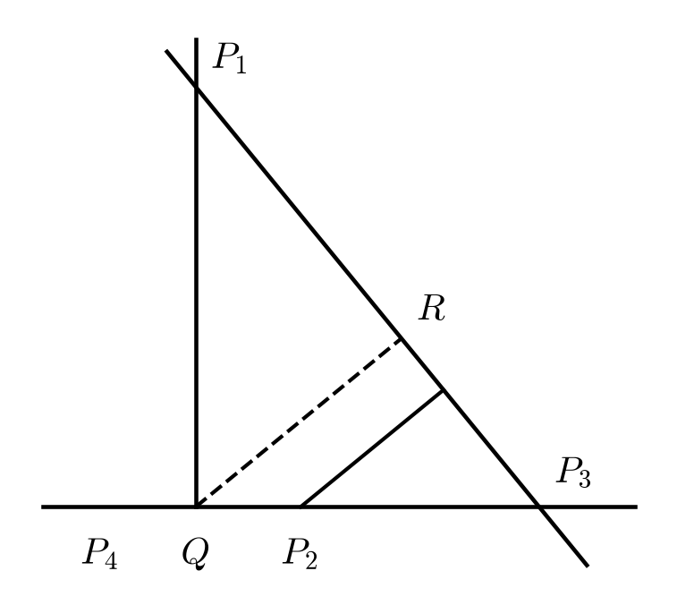

# 3. Бүрэн эрэмбэлэгдэх зарчим ба төгсгөлгүй буурах арга

Бүрэн эрэмбэлэгдэх зарчим нь математикийн олимпиадад түгээмэл хэрэглэгддэг. Түүний стандарт хэлбэр нь дараах байдалтай байна:

::: {.callout-tip icon=false title="Бүрэн эрэмбэлэгдэх зарчим"}
Бүх эерэг бүхэл тооны $\mathbf{N}^*$ олонлогийн дурын хоосон биш $T$ дэд олонлогт хамгийн бага элемент заавал оршино. Өөрөөр хэлбэл, аливаа $t \in T$ хувьд $t_0 \leqslant t$ байх эерэг бүхэл $t_0 \in T$ тоо оршино.
:::

**Баталгаа.** $S = \{x \mid x \in \mathbf{N}^*, \; x \notin T\}$ олонлогийг авч үзье. $S = \mathbf{N}^* \setminus T$ болохыг хялбархан харж болно.  
Хэрэв $T$ олонлогт хамгийн бага бүхэл тоо байхгүй бол эерэг бүхэл тоо бүр $S$-д харьяалагдах бөгөөд улмаар $T = \varnothing$ болж зөрчил үүснэ гэдгийг баталъя.  
Эхлээд $1 \in S$. Эс тэгвээс $1 \in T$ болж, $1$ нь $T$-ийн хамгийн бага элемент болно.  
Дараа нь $1, 2, \dots, n \in S$, өөрөөр хэлбэл $1, 2, \dots, n$ тоонууд $T$-ийн элемент биш гэж таамаглая. Хэрэв $n + 1 \in T$ бол $n + 1$ нь $T$-ийн хамгийн бага элемент болж зөрчил үүснэ. Иймд $n + 1 \in S$.  
Тиймээс математикийн индукцийн хоёрдугаар хэлбэр ёсоор аливаа $n \in \mathbf{N}^*$ хувьд $n \in S$ гэж дүгнэж болно.  
Ийнхүү бүрэн эрэмбэлэгдэх зарчим үнэн болох нь батлагдлаа.

Тодорхой бодлогуудыг бодох үед бид энэ зарчмын зарим өөр хэлбэр буюу мөрдөлгөөнүүдийг түгээмэл ашигладаг:

1. **Хамгийн их бүхэл тооны зарчим.** $M$ нь эерэг бүхэл тооны $\mathbf{N}^*$ олонлогийн хоосон биш дэд олонлог бөгөөд дээрээсээ зааглагдсан байг (өөрөөр хэлбэл, аливаа $x \in M$ хувьд $x \leqslant a$ байх $a \in \mathbf{N}^*$ оршино). Тэгвэл $M$ олонлогт хамгийн их элемент оршино.
2. Бодит тооны дурын төгсгөлөг олонлогт хамгийн бага ба хамгийн их элемент оршино.
3. **Эрэмбийн аксиом.** $n$ ширхэг бодит тооноос тогтох $M$ олонлогийг $x_1 < x_2 < \dots < x_n$ байхаар $M = \{x_1, \dots, x_n\}$ гэж бичиж болно.()

Бүрэн эрэмбэлэгдэх зарчим нь бодлого бодохдоо захын утгаас (хамгийн бага эсвэл хамгийн их элементээс) эхлэхийг бидэнд чиглүүлдэг. Энэ нь эргэж буцах санааг агуулдаг тул бид бодлогын мөн чанар руу эргэн хандах хэрэгтэй.

Төгсгөлгүй буурах арга нь тодорхойгүй тэгшитгэл бодохоос үүдэлтэй. Ферма ойролцоогоор $400$ жилийн өмнө $x^4 + y^4 = z^4$ тэгшитгэлд эерэг бүхэл шийд байхгүйг батлахдаа энэ аргыг ашигласан юм. Түүний үндсэн санаа нь дараах байдалтай:
> «Хэрэв эерэг бүхэл $n$ тооны тухай $P(n)$ өгүүлбэр $n = n_0$ үед үнэн гэдгээс ямар нэг $n_1 \in \mathbf{N}^*$ ($n_1 < n_0$) тооны хувьд $P(n_1)$ мөн үнэн гэдгийг баталж чадвал $P(n)$ өгүүлбэр ямар ч $n \in \mathbf{N}^*$ хувьд биелэхгүй.»

Энэ нь бүрэн эрэмбэлэгдэх зарчмын нэг хэлбэр бөгөөд тооны онолын бодлого, ялангуяа тодорхойгүй тэгшитгэл бодоход түгээмэл хэрэглэгддэг.

---

::: {.callout-note icon=false title="Жишээ 1"}
Хавтгайд ерөнхий байрлалтай (ялгаатай) дурын $n$ цэг өгөгдөв. Эдгээр цэгийн хоёрыг нь дайрч, үлдсэн $n - 2$ цэгийг гаднаа үлдээх тойрог оршихыг батал.
:::

**Баталгаа.** Эдгээр $n$ цэгийн хоёр бүрийн хооронд нийт $C_n^2$ ширхэг зай байх тул хоорондын зай нь хамгийн бага байх хоёр цэг (тэдгээрийг $A$ ба $B$ гэе) заавал оршино (хэрэв ийм хос цэг нэгээс олон байвал аль нэгийг нь авъя).  
Одоо $AB$ хэрчмийг диаметрээ болгосон $P$ тойргийг авч үзье. Тэгвэл $P$ тойрог доторх (эсвэл дээрх) дурын $C$ цэгийн хувьд $ABC$ гурвалжны хамгийн урт тал нь $AB$ байна. $AB$ нь хамгийн бага зай тул үлдсэн $n - 2$ цэг $P$ тойргийн гадна оршино гэж дүгнэж болно. Өгүүлбэр батлагдлаа.

---

::: {.callout-note icon=false title="Жишээ 2"}
Дараах тэгшитгэлийг хангах рационал $x, y, z$ тоонууд оршихгүй гэдгийг батал:
$$x^2 + y^2 + z^2 + 3(x + y + z) + 5 = 0. \tag{1}$$
:::

**Баталгаа.** $(1)$-ийн хоёр талыг $4$-өөр үржүүлж, бүтэн квадрат ялгавал:
$$(2x + 3)^2 + (2y + 3)^2 + (2z + 3)^2 = 7.$$
Хэрэв $(1)$-ийг хангах рационал $x, y, z$ тоонууд оршдог бол
$$a^2 + b^2 + c^2 = 7m^2 \tag{2}$$
тодорхойгүй тэгшитгэлд $m > 0$ байх бүхэл шийд $(a, b, c, m)$ оршино.  
Хэрэв $(2)$-т $m_0 > 0$ байх бүхэл шийд $(a_0, b_0, c_0, m_0)$ оршдог бол $0 < m_1 < m_0$ байх өөр нэг бүхэл шийд $(a_1, b_1, c_1, m_1)$ олддог гэдгийг баталж чадвал төгсгөлгүй буурах санаа ёсоор $m_0 > m_1 > m_2 > \dots$ гэсэн эерэг бүхэл тооны буурах дараалал үүсэж зөрчилд хүрнэ.

Үнэхээр, хэрэв $m_0$ сондгой бол $m_0^2 \equiv 1 \pmod{8}$ тул $a_0^2 + b_0^2 + c_0^2 \equiv 7 \pmod{8}$ болно. Гэвч бүхэл тооны квадрат нь модуль $8$-аар $0, 1, 4$-тэй жишүү байдаг. Иймд $a_0^2 + b_0^2 + c_0^2 \equiv 0, 1, 2, 3, 4, 5, 6 \pmod{8}$ болох бөгөөд $a_0^2 + b_0^2 + c_0^2 \equiv 7 \pmod{8}$ байх боломжгүй. Энэ нь зөрчил тул $m_0$ тэгш байна. Одоо $a_0^2 + b_0^2 + c_0^2 = 7m_0^2 \equiv 0 \pmod{4}$ болно. Нөгөө талаас бүхэл тооны квадрат нь модуль $4$-өөр $0, 1$-тэй жишүү тул $a_0, b_0, c_0$ нь бүгд тэгш байх ёстой.  
Тэгвэл $a_1 = \frac{1}{2}a_0$, $b_1 = \frac{1}{2}b_0$, $c_1 = \frac{1}{2}c_0$, $m_1 = \frac{1}{2}m_0$ гэж авбал $0 < m_1 < m_0$ нөхцөлийг хангах $(a_1, b_1, c_1, m_1)$ шийд гарна.  
Дүгнэж хэлбэл, $(1)$ тэгшитгэлд рационал шийд байхгүй.

**Тайлбар.** Хамгийн бага элементээс эхлэх эсвэл тодорхой элементээс бага элементийг олох нь бидний энэ параграфт танилцуулж буй чухал санаа юм. Эдгээр нь үндсэндээ математикийн индукцийн тусгай хэлбэрүүд бөгөөд математикийн индукцийг эзэмшихэд тулгардаг бэрхшээл, сорилтыг харуулахын зэрэгцээ хүмүүсийг математикт татдаг гоо сайхныг илтгэнэ.

---

::: {.callout-note icon=false title="Жишээ 3"}
Хавтгайд нэг шулуун дээр оршдоггүй $n$ ширхэг $P_1, P_2, \dots, P_n$ цэг өгөгдөв. Эдгээр цэгийн яг хоёрыг нь дайрсан ядаж нэг шулуун оршихыг батал.
:::

**Баталгаа.** Энэ бол алдарт Сильвестрийн теорем юм. Үүнийг батлах олон арга бий. Бүрэн эрэмбэлэгдэх зарчмыг ашигласан товч баталгааг толилуулъя.

$P_1, \dots, P_n$ цэгүүдийн ядаж хоёрыг нь дайрсан $P_i P_j$ шулуунуудыг авч үзье. Шулуун дээр оршдоггүй цэгүүдээс тэдгээр шулуун хүртэлх зай $0$-ээс их байна. Ийм зайн тоо төгсгөлөг (учир нь хамгийн ихдээ $C_n^2$ шулуун болон тэдгээр дээр оршдоггүй төгсгөлөг олон цэг бий). Иймд эдгээр зайн дунд хамгийн бага утга оршино.

Ерөнхий чанарыг алдагдуулахгүйгээр $P_1$ цэгээс $P_2 P_3$ шулуун хүртэлх зай хамгийн бага нь байг. $P_2 P_3$ шулуун дээр $P_1, \dots, P_n$ цэгүүдээс өөр цэг байхгүй гэдгийг баталъя.

Хэрэв $P_2 P_3$ шулуун дээр өөр нэг $P_4$ цэг оршдог бол $P_1$ цэгээс $P_2 P_3$ шулуунд буулгасан проекцийг $Q$ гэе. Тэгвэл $P_2, P_3, P_4$ гурван цэгийн ядаж хоёр нь $Q$ цэгийн нэг талд оршино. $P_2$ ба $P_3$ цэгүүд $Q$-ийн нэг талд оршиж, $|QP_2| < |QP_3|$ байг (Зураг 4-ийг үз).

{fig-align="center" width="180px"}

Тэгвэл $P_2$ цэгээс $P_1 P_3$ шулуун хүртэлх зай нь $Q$ цэгээс $P_1 P_3$ шулуун хүртэлх $QR$ зайнаас бага буюу тэнцүү бөгөөд $QR < P_1 Q$ тул $P_1 Q$ нь хамгийн бага зай гэдэгтэй зөрчилдөнө. Иймд $P_2 P_3$ шулуун дээр өөр цэг оршихгүй.  
Тиймээс өгүүлбэр үнэн.

---

::: {.callout-note icon=false title="Жишээ 4"}
Дараах тодорхойгүй тэгшитгэлд эерэг бүхэл шийд байхгүйг батал:
$$x^4 + y^4 = z^4.$$
:::

**Баталгаа.** Дараах тэгшитгэлд эерэг бүхэл шийд байхгүйг батлахад хангалттай:
$$x^4 + y^4 = z^2. \tag{1}$$
Хэрэв шийд оршдог бол $(1)$-ийн бүх эерэг бүхэл шийдүүдийн дундаас $z$ нь хамгийн бага байх $(x, y, z)$ шийдийг авъя. Одоо $x$ ба $y$-ийн хамгийн их ерөнхий хуваагчийг $d$ гэе, өөрөөр хэлбэл $(x, y) = d$.  
Тэгвэл $d^2 \mid (x^4 + y^4)$ тул $d^2 \mid z^2$, улмаар $d \mid z$ болно. Иймд $d = 1$ (эс тэгвээс $\left(\frac{x}{d}, \frac{y}{d}, \frac{z}{d}\right)$ нь мөн $(1)$-ийн шийд болж $z$-ийн хамгийн бага гэдэгтэй зөрчилдөнө). Тиймээс $(x^2, y^2, z)$ нь
$$u^2 + v^2 = w^2 \tag{2}$$
тэгшитгэлийн харилцан анхны шийд болно.

$y^2$-ийг тэгш гэж үзье. $(2)$-ийн ерөнхий шийдээс нэг нь сондгой, нөгөө нь тэгш бөгөөд $(a, b) = 1$ байх $a, b \in \mathbf{N}^*$ тоонууд оршиж,
$$x^2 = a^2 - b^2, \quad y^2 = 2ab, \quad z = a^2 + b^2$$
биелнэ.  
$y^2$ тэгш тул $x$ сондгой байна. $x^2 + b^2 = a^2$ гэдгээс нэг нь сондгой, нөгөө нь тэгш бөгөөд $(m, n) = 1$ байх $m, n \in \mathbf{N}^*$ тоонууд оршиж,
$$x = m^2 - n^2, \quad b = 2mn, \quad a = m^2 + n^2$$
болно.  
Тэгвэл $y^2 = 4mn(m^2 + n^2)$ болно. $(m, n) = 1$ тул $(m, m^2 + n^2) = (n, m^2 + n^2) = 1$ байна.  
Иймд $m^2 + n^2, m, n$ нь бүгд бүтэн квадратууд болно.

Тэгвэл $m = r^2$, $n = s^2$, $m^2 + n^2 = z_1^2$ ($r, s, z_1 \in \mathbf{N}^*$) гэж бичье. Тэгвэл $r^4 + s^4 = z_1^2$ болох бөгөөд $z_1^2 = a < z$ байна. Энэ нь $(x, y, z)$ шийд дэх $z$ нь бүх шийдийн дотроос хамгийн бага нь гэсэнтэй зөрчилдөнө.  
Тиймээс $(1)$ тэгшитгэлд эерэг бүхэл шийд байхгүй. Ийнхүү өгүүлбэр батлагдлаа.

**Тайлбар.** Бид төгсгөлгүй буурах аргын өөр нэг хэлбэрийг ашиглалаа:
> «Хэрэв эерэг бүхэл $n$ тооны тухай $P(n)$ өгүүлбэр зарим $n \in \mathbf{N}^*$ хувьд үнэн бол $P(n)$ үнэн байх хамгийн бага бүхэл тоог $n_0$ гэж авъя ($n_0$ орших нь бүрэн эрэмбэлэгдэх зарчмаар баталгаажна). Хэрэв $P(n_1)$ үнэн байх $n_1 \in \mathbf{N}^*$ ($n_1 < n_0$) тоо олддог гэдгийг баталж чадвал $P(n)$ өгүүлбэр ямар ч $n \in \mathbf{N}^*$ хувьд биелэхгүй.»

---

::: {.callout-note icon=false title="Жишээ 5"}
$n$ нь өгөгдсөн эерэг бүхэл тоо байг. Хавтгайн тэг биш векторуудын төгсгөлөг $M$ олонлог нь $2n$-ээс олон элементтэй бөгөөд дараах хоёр нөхцөлийг хангаж чадах уу?

1. $M$ олонлогийн дурын $n$ ширхэг векторын хувьд тэдгээртэй нийлээд $2n$ векторын нийлбэр тэг байх өөр $n$ ширхэг вектор $M$-ээс олдоно;
2. $M$ олонлогийн дурын $n$ ширхэг векторын хувьд тэдгээртэй нийлээд $2n - 1$ векторын нийлбэр тэг байх өөр $n - 1$ ширхэг вектор $M$-ээс олдоно.
:::

**Бодолт.** Ийм $M$ олонлог оршихгүй.  
Үнэхээр, хэрэв ийм $M$ олонлог оршдог бол $M$ нь төгсгөлөг тул түүнээс $n$ ширхэг вектор сонгох боломжийн тоо мөн төгсгөлөг байна. Тиймээс сонгосон $n$ векторын нийлбэрийн урт хамгийн их байх сонголт заавал оршино. Тэдгээр $n$ векторыг $\boldsymbol{u}_1, \boldsymbol{u}_2, \dots, \boldsymbol{u}_n$ гэж тэмдэглээд $\boldsymbol{u}_1 + \boldsymbol{u}_2 + \dots + \boldsymbol{u}_n = \boldsymbol{s}$ гэе.

Координатын эхээс $\boldsymbol{s}$ векторт перпендикуляр $l$ шулуун татъя. Тэгвэл $l$ шулуун хавтгайг хоёр хагас хавтгайд хуваана. $M$ олонлогийн векторуудаас $\boldsymbol{s}$ векторын орших талд байрлах векторуудын олонлогийг $M_1$, харин $\boldsymbol{s}$-ийн эсрэг талд эсвэл $l$ шулуун дээр орших векторуудын олонлогийг $M_2$ гэе. Тэгвэл $M_1 \cap M_2 = \varnothing$ ба $M_1 \cup M_2 = M$ болно.

$(2)$ нөхцөл ёсоор $\boldsymbol{u}_1 + \dots + \boldsymbol{u}_n + \boldsymbol{v}_1 + \dots + \boldsymbol{v}_{n-1} = \boldsymbol{0}$ байх $\boldsymbol{v}_1, \dots, \boldsymbol{v}_{n-1} \in M$ векторууд оршино. Өөрөөр бичвэл:
$$\boldsymbol{v}_1 + \dots + \boldsymbol{v}_{n-1} = -\boldsymbol{s}.$$
Одоо $\boldsymbol{v} \in M_2$ бөгөөд $\boldsymbol{v} \notin \{\boldsymbol{v}_1, \dots, \boldsymbol{v}_{n-1}\}$ байх $\boldsymbol{v}$ вектор оршихгүй гэдгийг баталъя.  
Хэрэв ийм $\boldsymbol{v}$ вектор оршдог бол $\boldsymbol{v} \cdot \boldsymbol{s} \leqslant 0$ байна. Иймд:
$$|\boldsymbol{v}_1 + \dots + \boldsymbol{v}_{n-1} + \boldsymbol{v}|^2 = |\boldsymbol{v} - \boldsymbol{s}|^2 = |\boldsymbol{s}|^2 - 2\boldsymbol{v} \cdot \boldsymbol{s} + |\boldsymbol{v}|^2 > |\boldsymbol{s}|^2,$$
энэ нь бидний $\boldsymbol{u}_1, \dots, \boldsymbol{u}_n$ векторуудыг сонгосон (хамгийн их урттай байх) нөхцөлтэй зөрчилдөнө.  
Тиймээс $|M_2| \leqslant n - 1$.

Нөгөө талаас $(1)$ нөхцөлөөс $\boldsymbol{u}_1 + \dots + \boldsymbol{u}_n + \boldsymbol{u}'_1 + \dots + \boldsymbol{u}'_n = \boldsymbol{0}$ байх $\boldsymbol{u}'_1, \dots, \boldsymbol{u}'_n \in M$ векторууд оршино. Өөрөөр хэлбэл, $\boldsymbol{u}'_1 + \dots + \boldsymbol{u}'_n = -\boldsymbol{s}$. Үүнд $(2)$ нөхцөлийг хэрэглэвэл $\boldsymbol{u}'_1 + \dots + \boldsymbol{u}'_n + \boldsymbol{v}'_1 + \dots + \boldsymbol{v}'_{n-1} = \boldsymbol{0}$, өөрөөр хэлбэл $\boldsymbol{v}'_1 + \dots + \boldsymbol{v}'_{n-1} = \boldsymbol{s}$ байх $\boldsymbol{v}'_1, \dots, \boldsymbol{v}'_{n-1}$ векторууд оршино.  
Үүнтэй яг ижил аргаар $\boldsymbol{v}' \in M_1$ бөгөөд $\boldsymbol{v}' \notin \{\boldsymbol{v}'_1, \dots, \boldsymbol{v}'_{n-1}\}$ байх $\boldsymbol{v}'$ вектор оршихгүй гэдгийг баталж чадна. Иймд $|M_1| \leqslant n - 1$.  
Эндээс $|M| \leqslant 2n - 2$ болж зөрчил үүснэ. Тиймээс дээрх нөхцөлүүдийг хангах $M$ олонлог оршихгүй.

---

::: {.callout-note icon=false title="Жишээ 6"}
$\alpha$ нь өгөгдсөн эерэг бүхэл тоо байг. Дараах тэгшитгэлийг хангах $x, y \in \mathbf{N}^*$ орших байх хамгийн их эерэг бүхэл $\beta$ тоог ол:
$$\beta = \frac{x^2 + y^2 + \alpha}{xy}. \tag{1}$$
:::

**Бодолт.** $\beta = \alpha + 2$ үед $x = y = 1$ гэж авахад $(1)$ биелэхийг ажиглавал $\beta_{\max} \geqslant \alpha + 2$ байна.

Нөгөө талаас $\beta$ нь нөхцөлийг хангах эерэг бүхэл тоо байг. $(1)$ тэгшитгэлийг хангах бүх эерэг бүхэл тоон хосуудын дотроос (энд $\beta$-г тогтмол гэж үзнэ) $x + y$ нийлбэр нь хамгийн бага байх $(x, y)$ хосыг авъя.  
- Хэрэв $x = y$ бол $\beta = \frac{2x^2 + \alpha}{x^2} = 2 + \frac{\alpha}{x^2} \leqslant 2 + \alpha$.
- Хэрэв $x \neq y$ бол ерөнхий чанарыг алдагдуулахгүйгээр $x > y$ гэж үзье. Тэгвэл $x$-ийн хувьд авч үзсэн
  $$x^2 - \beta y \cdot x + y^2 + \alpha = 0 \tag{2}$$
  квадрат тэгшитгэлд өөр нэг бодит язгуур $\bar{x}$ оршино.

Виетийн теорем болон $(2)$-оос $\bar{x} = \beta y - x \in \mathbf{Z}$ гэдгийг гаргаж болно. Мөн $x \cdot \bar{x} = y^2 + \alpha$ буюу $\bar{x} = \frac{y^2 + \alpha}{x} > 0$ гэдгийг тооцвол $\bar{x}$ нь эерэг бүхэл тоо болно. Тэгвэл $(\bar{x}, y)$ хос нь мөн $(1)$-ийг хангах эерэг бүхэл тоон хос болно. Тиймээс:
$$\bar{x} + y = \frac{y^2 + \alpha}{x} + y \geqslant x + y.$$
Энд бид $x + y$ нь хамгийн бага гэдгийг ашиглалаа.  
Тэгвэл $x^2 \leqslant y^2 + \alpha$ ба $x \geqslant y + 1$ болно. Цаашилбал:
$$\begin{aligned}
\beta = \frac{x^2 + y^2 + \alpha}{xy} &\leqslant \frac{2(y^2 + \alpha)}{xy} \leqslant \frac{2(y^2 + \alpha)}{y(y + 1)} \\
&= \frac{2y^2}{y^2 + y} + \frac{2\alpha}{y(y + 1)} < 2 + \alpha.
\end{aligned}$$
Энэ нь $\beta_{\max} \leqslant 2 + \alpha$ болохыг харуулна.  
Дүгнэж хэлбэл, $\beta$-гийн хамгийн их утга нь $\alpha + 2$ байна.

---

::: {.callout-note icon=false title="Жишээ 7"}
$1$-ээс их дурын хуваагч бүр нь $a^r + 1$ ($a, r \in \mathbf{N}^*$, $r \geqslant 2$) хэлбэртэй бичигддэг байх $1$-ээс их бүх бүхэл $n$ тоог ол.
:::

**Бодолт.** Нөхцөлийг хангах бүх эерэг бүхэл тооны олонлогийг $S$ гэе; өөрөөр хэлбэл, аливаа $n \in S$ ($n > 1$) тооны $1$-ээс их дурын хуваагч бүр $a^r + 1$ ($a, r \in \mathbf{N}^*$, $r \geqslant 2$) хэлбэртэй бичигдэнэ.

Аливаа $n \in S$ ($n > 2$) хувьд $n = a^r + 1$ байх $a, r \in \mathbf{N}^*$ ($a, r > 1$) тоонууд оршино. $n$-ийг энэ хэлбэрээр бичих үед $a$ нь хамгийн бага нь байг (өөрөөр хэлбэл, $a = b^t$ байх $b, t \in \mathbf{N}^*$, $t > 1$ оршихгүй). Тэгвэл $r$ заавал тэгш байх ёстой (эс тэгвээс $r$-ийг сондгой гэе. Тэгвэл $(a + 1) \mid n$ тул $a + 1$ нь $b^t + 1$ хэлбэрээр бичигдэж $a = b^t$ болно. Энэ нь $a$ хамгийн бага гэдэгтэй зөрчилдөнө). Иймд $S$ олонлогийн $1$-ээс их элемент бүр $n = x^2 + 1$ ($x \in \mathbf{N}^*$) хэлбэрээр бичигдэнэ.

Одоо $S$ олонлогийн бүх $n$ элементийг олъё.  
Хэрэв $n$ анхны тоо бол $n$ нь $x^2 + 1$ хэлбэртэй бичигддэг анхны тоо байна.  
Хэрэв $n$ зохиомол тоо бол бодлогыг хоёр тохиолдлоор авч үзье:
1. Хэрэв $n$ сондгой зохиомол тоо бол $p, q, pq \in S$ байх сондгой анхны $p, q$ тоонууд оршино. Тэгвэл:
   $$p = 4a^2 + 1, \quad q = 4b^2 + 1, \quad pq = 4c^2 + 1$$
   нөхцөлийг хангах $a, b, c \in \mathbf{N}^*$ оршино.  
   $a \leqslant b < c$ гэж үзэж болно. Тиймээс $pq - q = 4(c^2 - b^2)$ болох тул $q \mid 4(c - b)(c + b)$. $q$ нь сондгой анхны тоо тул $q \mid (c - b)$ эсвэл $q \mid (c + b)$ байна. Эндээс $q < 2c$ болж $pq < 4c^2 < 4c^2 + 1 = pq$ гэсэн зөрчилд хүрнэ.
2. Хэрэв $n$ тэгш зохиомол тоо бол $2^2 \notin S$ гэдгийг өмнөх гаргалгаатай хослуулбал $n$ зөвхөн $2q$ хэлбэртэй байж чадна (энд $q$ нь сондгой анхны тоо). Одоо $q, 2q \in S$ тул:
   $$q = 4a^2 + 1, \quad 2q = b^2 + 1$$
   байх $a, b \in \mathbf{N}^*$ оршино.  
   Иймд $q = b^2 - 4a^2 = (b - 2a)(b + 2a)$ болох тул $b - 2a = 1$, $b + 2a = q$ байна. Цаашилбал $q - 1 = 4a$ болно. $q - 1 = 4a^2$ гэдгийг тооцвол $4a = 4a^2$ буюу $a = 1, b = 3, q = 5, n = 10$ гарна. Өөрөөр хэлбэл, $S$ олонлогт цорын ганц тэгш зохиомол тоо $10$ оршино.

Дүгнэж хэлбэл, аливаа $n \in S$ нь $10$ эсвэл $x^2 + 1$ хэлбэртэй анхны тоо байх ёстой. Ийм $n$ тоо бодлогын нөхцөлийг хангах нь илэрхий. Иймд:
$$S = \{x^2 + 1 \mid x \in \mathbf{N}^*, \; x^2 + 1 \text{ нь анхны тоо}\} \cup \{10\}.$$

---

::: {.callout-note icon=false title="Жишээ 8"}
Ширээн дээр хоёр овоо зоос байв. Хоёр овооны нийт жин тэнцүү болох нь өгөгджээ. Цаашилбал, аливаа эерэг бүхэл $k$ тооны хувьд (аль ч овооны зоосны тооноос бага) эхний овооны хамгийн хүнд $k$ зоосны нийт жин нь хоёр дахь овооны хамгийн хүнд $k$ зоосны нийт жингээс хэтрэхгүй. Дурын эерэг $x$ тооны хувьд хэрэв хоёр овооны $x$-ээс багагүй жинтэй зооснуудыг яг $x$ жинтэй зооснуудаар сольбол энэ үйлдлийн дараа эхний овооны нийт жин хоёр дахь овооны нийт жингээс багагүй болохыг батал.
:::

**Баталгаа.** Бодлогыг эрэмбийн аксиом ашиглан бодъё.  
Эхний овооны зооснуудын жин $x_1 \geqslant \dots \geqslant x_n$, хоёр дахь овооны зооснуудын жин $y_1 \geqslant \dots \geqslant y_m$ байг. Бодлогын нөхцөлөөс аливаа $k \leqslant \min\{m, n\}$ хувьд $x_1 + \dots + x_k \leqslant y_1 + \dots + y_k$ гэдэг нь мөрдөн гарна.  
Аливаа $x \in \mathbf{R}$ хувьд:
$$\begin{aligned}
x_1 \geqslant \dots \geqslant x_s &\geqslant x > x_{s+1} \geqslant \dots \geqslant x_n, \\
y_1 \geqslant \dots \geqslant y_t &\geqslant x > y_{t+1} \geqslant \dots \geqslant y_m
\end{aligned}$$
байг. Бид дараах тэнцэтгэл бишийг батлах шаардлагатай:
$$sx + x_{s+1} + \dots + x_n \geqslant tx + y_{t+1} + \dots + y_m. \tag{1}$$
$s$ эсвэл $t$ оршихгүй үед (нөхцөл ёсоор хэрэв $t$ оршихгүй бол $s$ мөн оршихгүй гэдгийг ажиглая) $(1)$ тэнцэтгэл биш нь $x_1 + \dots + x_n = y_1 + \dots + y_m$ тэнцэтгэлээс илэрхий мөрдөн гарна. Цаашид $s$ ба $t$ хоёулаа орших тохиолдлыг авч үзье.

$x_1 + \dots + x_n = y_1 + \dots + y_m = A$ гэе. Тэгвэл $(1)$ нь дараах тэнцэтгэл биштэй эквивалент болно:
$$\begin{aligned}
sx + (A - x_1 - \dots - x_s) &\geqslant tx + (A - y_1 - \dots - y_t) \\
\iff x_1 + \dots + x_s + (t - s)x &\leqslant y_1 + \dots + y_t. \tag{2}
\end{aligned}$$
- Хэрэв $t \geqslant s$ бол:
  $$\begin{aligned}
  x_1 + \dots + x_s + (t - s)x &= x_1 + \dots + x_s + \underbrace{x + \dots + x}_{t - s} \\
  &\leqslant y_1 + \dots + y_s + y_{s+1} + \dots + y_t
  \end{aligned}$$
  болж $(2)$ тэнцэтгэл биш биелнэ.
- Хэрэв $t < s$ бол $(2)$ нь дараах тэнцэтгэл биштэй эквивалент:
  $$x_1 + \dots + x_s \leqslant y_1 + \dots + y_t + \underbrace{x + \dots + x}_{s - t}. \tag{3}$$
  Бодлогын нөхцөлөөс:
  $$\begin{aligned}
  x_1 + \dots + x_s &\leqslant y_1 + \dots + y_t + y_{t+1} + \dots + y_s \\
  &\leqslant y_1 + \dots + y_t + \underbrace{x + \dots + x}_{s - t}
  \end{aligned}$$
  болох тул $(3)$ биелнэ.

Дүгнэж хэлбэл, өгүүлбэр үнэн.