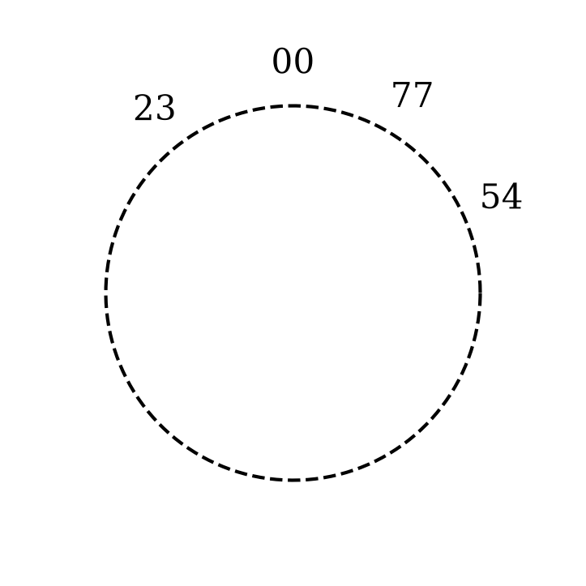

# 8. Үет дараалал

Хэрэв аливаа $n \geqslant n_0$ хувьд $a_n = a_{n+T}$ биелэх эерэг бүхэл $T$ ба $n_0$ тоонууд оршдог бол $\{a_n\}$ дарааллыг **үет дараалал** гэнэ. Цаашилбал, хэрэв $n_0 = 1$ бол $\{a_n\}$-ийг **цэвэр үет дараалал**, харин $T$-г $\{a_n\}$-ийн **үе** гэж нэрлэнэ.

Үет дарааллын тодорхойлолт ёсоор хэрэв $T$ нь $\{a_n\}$-ийн үе бол аливаа $m \in \mathbf{N}^*$ хувьд $mT$ нь мөн $\{a_n\}$-ийн үе болно. Дээрх чанарыг тооны онолын алдарт Безугийн теоремтой хослуулбал дараах теорем гарна:

::: {.callout-tip icon=false title="Теорем 1"}
Хэрэв $T_1$ ба $T_2$ нь $\{a_n\}$ үет дарааллын үеүд бол $(T_1, T_2)$ ($T_1$ ба $T_2$-ийн хамгийн их ерөнхий хуваагч) нь мөн $\{a_n\}$-ийн үе болно.
:::

Энэ теоремоос үет $\{a_n\}$ дараалалд хамгийн бага эерэг үе оршино гэдгийг дүгнэж болох бөгөөд энэ нь үет $f$ функц хамгийн бага эерэг үегүй байж болдогтой эрс ялгаатай юм.

Бүхэл тоон $\{a_n\}$ дараалал нь өөрөө үет дараалал биш боловч ямар нэг эерэг бүхэл $m$ тооны хувьд **модуль $m$-ээр үет дараалал** байж болно. Энэ нь модульчлагдсан үет дарааллын ойлголт юм. Өөрөөр хэлбэл, аливаа $n \geqslant n_0$ хувьд $a_{n+T} \equiv a_n \pmod{m}$ биелэх $T, n_0 \in \mathbf{N}^*$ оршино.

::: {.callout-tip icon=false title="Теорем 2"}
Хэрэв бүхэл тоон $\{a_n\}$ дараалал нь тогтмол коэффициенттэй рекуррент дараалал бол аливаа $m \in \mathbf{N}^*$ хувьд $\{a_n\}$ нь ямагт модуль $m$-ээр үет дараалал болно.
:::

Үнэхээр, хэрэв $\{a_n\}$ нь тогтмол коэффициенттэй $k$-р эрэмбийн рекуррент дараалал бол дараах цуглуулгуудыг авч үзье:
$$(a_1, a_2, \dots, a_k), \quad (a_2, a_3, \dots, a_{k+1}), \quad \dots \tag{1}$$
$(a_1, a_2, \dots, a_k)$ цуглуулга дахь $x_i$ бүр модуль $m$-ээр зөвхөн $0, 1, 2, \dots, m - 1$ гэсэн утгуудыг авах тул $(1)$-д хамгийн олондоо $m^k$ ялгаатай цуглуулга байна. Тиймээс
$$(a_r, a_{r+1}, \dots, a_{r+k}) \equiv (a_t, a_{t+1}, \dots, a_{t+k}) \pmod{m}$$
нөхцөлийг хангах $r, t \in \mathbf{N}^*$ ($r < t$) оршино.  
$T = t - r$ гэе. $\{a_n\}$ нь тогтмол коэффициенттэй рекуррент дараалал гэдгийг тооцвол аливаа $n \geqslant r$ хувьд $a_{n+T} \equiv a_n \pmod{m}$ болно.  
Тиймээс Теорем 2 биелнэ.

---

::: {.callout-note icon=false title="Жишээ 1"}
$x_0, x_1$ нь эерэг бодит тоонууд бөгөөд $\{x_n\}$ дараалал нь
$$x_{n+2} = \frac{4\max\{x_{n+1}, 4\}}{x_n}, \quad n = 0, 1, 2, \dots$$
нөхцөлийг хангадаг бол $x_{2011}$-ийн утгыг ол.
:::

**Бодолт.** Тооцоог хялбар болгохын тулд $x_n = 4y_n$ гэе. Тэгвэл:
$$y_{n+2} = \frac{\max\{y_{n+1}, 1\}}{y_n}, \quad n = 0, 1, 2, \dots$$
Шууд тооцоолол хийснээр бид дараах хүснэгтийг гарган авч чадна:

| | $y_0 \leqslant 1, \; y_1 \leqslant 1$ | $y_0 \leqslant 1, \; y_1 > 1$ | $y_0 > 1, \; y_1 \leqslant 1$ | $y_0 > 1, \; y_1 > 1$ |
| :--- | :---: | :---: | :---: | :---: |
| $y_2 =$ | $\dfrac{1}{y_0}$ | $\dfrac{y_1}{y_0}$ | $\dfrac{1}{y_0}$ | $\dfrac{y_1}{y_0}$ |
| $y_3 =$ | $\dfrac{1}{y_0 y_1}$ | $\dfrac{1}{y_0}$ | $\dfrac{1}{y_1}$ | $\max\left\{\dfrac{1}{y_0}, \dfrac{1}{y_1}\right\}$ |
| $y_4 =$ | $\dfrac{1}{y_1}$ | $\dfrac{1}{y_1}$ | $\dfrac{y_0}{y_1}$ | $\dfrac{y_0}{y_1}$ |
| $y_5 =$ | $y_0$ | $y_0$ | $y_0$ | $y_0$ |
| $y_6 =$ | $y_1$ | $y_1$ | $y_1$ | $y_1$ |

Тиймээс $\{y_n\}$ нь $5$ үетэй цэвэр үет дараалал болох ба $\{x_n\}$ мөн адил байна. Үр дүнд нь $x_{2011} = x_1$.

**Тайлбар.** Дээрх бодлогод өгөгдсөн рекуррент хамаарал нь Линессийн (Lyness) тэгшитгэлийн тусгай хэлбэр юм. Энд шууд тооцоолох замаар үеийг тодорхойлох нь бутархай (үет) рекуррент дараалалтай ажиллах шулуун бөгөөд үр дүнтэй арга юм.

---

::: {.callout-note icon=false title="Жишээ 2"}
$0 \leqslant x_0 < 1$ бөгөөд $\{x_n\}$ дараалал нь
$$x_{n+1} = \begin{cases} 2x_n - 1, & \text{хэрэв } \frac{1}{2} \leqslant x_n < 1 \text{ бол}, \\ 2x_n, & \text{хэрэв } 0 \leqslant x_n < \frac{1}{2} \text{ бол} \end{cases} \quad (n = 0, 1, 2, \dots)$$
ба $x_5 = x_0$ нөхцөлүүдийг хангадаг бол эдгээр нөхцөлийг хангах хэдэн ширхэг дараалал орших вэ?
:::

**Бодолт.** $x_0$-ийг бэхэлбэл $\{x_n\}$ дараалал цор ганц утгаар тодорхойлогдохыг ажиглая. Иймд бид бодлогыг $x_0$ хэдэн ялгаатай утга авч чадахыг олох бодлого болгон хувиргалаа.

Энэ бодлогыг бодохын тулд хоёртын тооллын системийг ашиглая. $\{x_n\}$-ийг хоёртын тоогоор илэрхийлье. $x_n = (0.b_1 b_2 \dots)_2$ байг. Хэрэв $b_1 = 1$ бол $\frac{1}{2} \leqslant x_n < 1$ тул $x_{n+1} = 2x_n - 1 = (0.b_2 b_3 \dots)_2$; хэрэв $b_1 = 0$ бол $0 \leqslant x_n < \frac{1}{2}$ тул $x_{n+1} = 2x_n = (0.b_2 b_3 \dots)_2$ болно. Энэ нь $x_n = (0.b_1 b_2 \dots)_2$ үед ямагт $x_{n+1} = (0.b_2 b_3 \dots)_2$ биелэхийг харуулна (өөрөөр хэлбэл, бутархайн цэгийн ард байгаа эхний цифрийг «залгихтай» адил үйлдэл юм).

Одоо $x_0 = (0.a_1 a_2 \dots)_2$ гэе.  
Дээрх гаргалгаанаас $x_5 = (0.a_6 a_7 \dots)_2$ гэдгийг дүгнэж болно. $x_5 = x_0$ гэдгийг тооцвол $x_0$ нь хоёртын тооллын систем дэх үет бутархай болно:
$$x_0 = (0.\dot{a}_1 a_2 \dots \dot{a}_5)_2 = \frac{(a_1 \dots a_5)_2}{2^5 - 1},$$
энд $(a_1 \dots a_5)_2$ нь хоёртын тооллын систем дэх сөрөг биш бүхэл тоог илэрхийлнэ ($a_1, \dots, a_5$ нь бүгд $1$ биш гэдгийг анхаарна уу).  
Дүгнэж хэлбэл, $x_0$-ийн хувьд $2^5 - 1 = 31$ ялгаатай утга оршино (учир нь $a_1, \dots, a_5$ нь $0$ эсвэл $1$ утга авах боловч бүгд $1$ байж болохгүй). Өөрөөр хэлбэл, $31$ ялгаатай дараалал оршино.

**Тайлбар.** Бид энд хоёртын бичлэгийг ашиглан рекуррент хамаарлыг илүү зүй тогтолтой томьёо руу шилжүүллээ. Улмаар үүнийг дарааллын үет чанартай хослуулснаар уг дарааллын бүтцийг бүрэн атгаж чадлаа. Үндсэндээ бид ялгаатай огторгуйнуудын хооронд буулгалт хийж байна.

---

::: {.callout-note icon=false title="Жишээ 3"}
$f(x)$ нь бүхэл коэффициенттэй олон гишүүнт бөгөөд $\{a_n\}$ дараалал нь
$$a_0 = 0, \quad a_{n+1} = f(a_n), \quad n = 0, 1, 2, \dots$$
томьёогоор тодорхойлогдов. Хэрэв $\{a_n\}$ нь цэвэр үет дараалал бол $\{a_n\}$-ийн хамгийн бага эерэг үе $2$-оос ихгүй болохыг батал.
:::

**Баталгаа.** Бид энэ асуултыг хэрэв $a_m = 0$ байх $m \in \mathbf{N}^*$ оршдог бол $a_1 = 0$ эсвэл $a_2 = 0$ байна гэдгийг батлах бодлого болгон хувиргаж чадна.  
Безугийн (үржигдэхүүний) теорем ёсоор $f(x)$ нь бүхэл коэффициенттэй олон гишүүнт тул дурын $m, n \in \mathbf{Z}$ ($m \neq n$) хувьд $m - n \mid f(m) - f(n)$ биелнэ.  
Одоо $b_n = a_{n+1} - a_n$ ($n = 0, 1, 2, \dots$) гэе. Тэгвэл дээрх үр дүн болон $\{a_n\}$-ийн тодорхойлолт ёсоор $b_n \mid b_{n+1}$ байна (хэрэв $b_n = 0$ бол $b_{n+1} = f(a_{n+1}) - f(a_n) = 0$ гэдгийг ажиглая).  
$a_m = a_0 = 0$ тул $a_{m+1} = f(a_0) = a_1$ болно. Үр дүнд нь $b_m = b_0$.  
Хэрэв $b_0 = 0$ бол $a_0 = a_1 = \dots = a_m$ болж өгүүлбэр үнэн.  
Эсрэг тохиолдолд $|b_0| = |b_m| \neq 0$ болох ба $b_0 \mid b_1, b_1 \mid b_2, \dots, b_{m-1} \mid b_m$ гэдгийг тооцвол $|b_0| = |b_1| = \dots = |b_m|$ гарна.  
$$b_0 + b_1 + \dots + b_{m-1} = a_m - a_0 = 0$$
тул $b_0, b_1, \dots, b_{m-1}$ тоонуудын хагас нь эерэг бүхэл, хагас нь сөрөг бүхэл тоонууд байна. Тиймээс $b_{k-1} = -b_k$ байх $k \in \{1, 2, \dots, m - 2\}$ орших ба улмаар $a_{k-1} = a_{k+1}$ болно. $\{a_n\}$-ийн тодорхойлолт ёсоор бүх $n \geqslant k - 1$ хувьд $a_{n+2} = a_n$ биелнэ. $n = m$ гэж авбал:
$$a_0 = a_m = a_{m+2} = f(a_{m+1}) = f(f(a_m)) = f(f(a_0)) = a_2.$$
Тэгвэл $a_2 = 0$.  
Иймд өгүүлбэр үнэн.

---

::: {.callout-note icon=false title="Жишээ 4"}
$m$ нь $1$-ээс их эерэг бүхэл тоо бөгөөд $\{x_n\}$ дараалал нь $x_1 = 1, x_2 = 2, \dots, x_m = m$ болон
$$x_{n+m} = x_{n+m-1} + x_n, \quad n = 1, 2, \dots \tag{1}$$
томьёогоор тодорхойлогдов. $\{x_n\}$ дараалалд бүгд $m$-д хуваагддаг дараалсан $m - 1$ ширхэг гишүүн оршихыг батал.
:::

**Баталгаа.** $\{x_k \pmod{m}\}$ дарааллыг авч үзье; энд $y_k$ гэж тэмдэглэсэн $x_k \pmod{m}$ нь $x_k$-г $m$-д хуваахад гарах үлдэгдлийг илэрхийлнэ. Бид $\{y_n\}$ дараалалд дараалсан $m - 1$ ширхэг тэг оршихыг батлах болно.

Теорем 2 болон $(1)$-ээс аливаа $k \geqslant n_0$ хувьд $y_{k+T} = y_k$ биелэх $n_0$ ба $T \in \mathbf{N}^*$ оршино. Тухайлбал:
$$y_{n_0 + m - 1} = y_{n_0 + m - 1 + T}, \quad y_{n_0 + m - 2} = y_{n_0 + m - 2 + T}.$$
Энэ хоёр тэгшитгэлийг хасаж, $(1)$ болон $y_k$-ийн тодорхойлолтыг тооцвол $y_{n_0 - 1} = y_{n_0 - 1 + T}$ гарах ба үүнтэй ижил аргаар бүх $k \geqslant 1$ хувьд $y_k = y_{k+T}$ болно.

Үр дүнгээ гаргах болон тооцоог хялбар болгохын тулд $\{x_n\}$-ийн дугаарыг $(1)$-ээр тодорхойлогдох рекуррент хамаарлын дагуу сөрөг бүхэл тоонууд руу өргөтгөе. Дээрхтэй хослуулбал аливаа $k \in \mathbf{Z}$ хувьд $y_k = y_{k+T}$ болно.  
Одоо $x_n = x_{n+m} - x_{n+m-1}$ гэдгээс $x_0 = x_{-1} = \dots = x_{-(m-2)} = 1$ (энд бид дурын $1 \leqslant j \leqslant m$ хувьд $x_j = j$ анхны нөхцөлийг ашиглалаа), цаашилбал $x_{-(m-1)} = x_{-m} = \dots = x_{-(2m-3)} = 0$ гэж дүгнэж болно. $y_k = y_{k+T}$ гэдгийг тооцвол:
$$(y_{-(2m-3)+T}, \dots, y_{-(m-1)+T}) = (y_{-(2m-3)}, \dots, y_{-(m-1)}) = (0, \dots, 0).$$
Гэсэн хэдий ч $y_{-(m-2)} = \dots = y_0 = 1$ тул $-(2m - 3) + T \geqslant 1$ байна. Энэ нь $\{y_n\}$ дарааллын эерэг дугаартай гишүүдийн дотор дараалсан $m - 1$ ширхэг тэг оршиж буйг харуулна.  
Иймд өгүүлбэр үнэн.

---

::: {.callout-note icon=false title="Жишээ 5"}
$m$ нь өгөгдсөн эерэг бүхэл тоо бөгөөд аливаа эерэг бүхэл $n$ тооны хувьд $S_m(n)$ нь аравтын тооллын систем дэх $n$ тооны цифр бүрийн $m$ зэргийн нийлбэрийг тэмдэглэе (жишээ нь, $S_3(172) = 1^3 + 7^3 + 2^3 = 352$).  
$n_0$ нь эерэг бүхэл тоо бөгөөд $n_k = S_m(n_{k-1})$ ($k = 1, 2, \dots$) дарааллыг авч үзье:

1. Аливаа эерэг бүхэл $n_0$ тооны хувьд $\{n_k\}$ дараалал нь ямагт үет дараалал болохыг батал;
2. $n_0$ өөрчлөгдөх үед $(1)$-д гарсан хамгийн бага эерэг үеүүдээс бүрдэх олонлог төгсгөлөг олонлог болохыг батал.
:::

**Баталгаа.** Эерэг бүхэл $n \geqslant 10^{m+1}$ тооны хувьд $10^p \leqslant n < 10^{p+1}$ байх $p \in \mathbf{N}^*$ ($p \geqslant m + 1$) оршино гэдгийг ажиглая. Тэгвэл $n$ нь аравтын тооллын системд $p + 1$ оронтой тоо болно. Тиймээс:
$$\begin{aligned}
S_m(n) &\leqslant (p + 1) \cdot 9^m < (p + 1) \cdot 9^{p-1} \\
&< 9^p + C_p^1 \cdot 9^{p-1} < (9 + 1)^p = 10^p \leqslant n.
\end{aligned}$$
Энэ нь $\{n_k\}$ дарааллын гишүүдийн хувьд хэрэв $n_k \geqslant 10^{m+1}$ бол $n_{k+1} = S_m(n_k) < n_k$ биелэхийг харуулна.  
Нөгөө талаас хэрэв эерэг бүхэл $n < 10^{m+1}$ бол:
$$S_m(n) \leqslant (m + 1) \cdot 9^m < (9 + 1)^{m+1} = 10^{m+1}.$$
Хэрэв $n_k < 10^{m+1}$ бол $n_{k+1} = S_m(n_k) < 10^{m+1}$ мөн биелэхийг харж болно.  
Дээрх шинжилгээнээс $k$ дугаар хангалттай их болоход заавал $n_k < 10^{m+1}$ болно. Иймд тодорхой нэг гишүүнээс эхлэн $\{n_k\}$-ийн гишүүн бүр $\{1, 2, \dots, 10^{m+1} - 1\}$ олонлогт харьяалагдана. Өөрөөр хэлбэл, аливаа $k \geqslant k_0$ хувьд $1 \leqslant n_k \leqslant 10^{m+1} - 1$ биелэх $k_0 \in \mathbf{N}^*$ оршино. Үүнийг Дирихлейн зарчимтай хослуулбал $n_r = n_s$ байх $r, s \in \mathbf{N}^*$ ($r > s \geqslant k_0$) оршино. $\{n_k\}$-ийн тодорхойлолт ёсоор $k \geqslant s$ үед $n_k = n_{k+T}$ болох ба энд $T = r - s$ ба $T \leqslant 10^{m+1} - 1$ байна.  
Иймд $\{n_k\}$ нь аливаа $n_0 \in \mathbf{N}^*$ хувьд ямагт үет дараалал байх ба хамгийн бага эерэг үе нь $10^{m+1} - 1$-ээс хэтрэхгүй.  
Тиймээс $(1)$ ба $(2)$ биелнэ.

---

::: {.callout-note icon=false title="Жишээ 6"}
Эхлээд эерэг бүхэл $a_0$ тоог сонгож, дараа нь $a_1 \in \{a_0 + 54, a_0 + 77\}$ гэх мэтээр үргэлжлүүлэв. $a_k$-г бэхэлсэн үед бид $a_{k+1} \in \{a_k + 54, a_k + 77\}$ гэж сонгож чадна. Ийм замаар төгсгөлгүй $\{a_n\}$ дараалал байгуулав. Энэ дараалалд сүүлийн хоёр цифр нь ижил байх гишүүн ямагт оршино гэдгийг батал.
:::

**Баталгаа.** Бодлогыг $a_n$-ийг модуль $100$-аар авч хэлэлцье. $a_n$-ийг $100$-д хуваахад гарах үлдэгдлийг $b_n$ гэе. Өөрөөр хэлбэл, $b_n$ нь $00, 01, \dots, 99$-ийн дундах хоёр оронтой тоо юм.  
$\{a_n\}$-ийн тодорхойлолт ёсоор аливаа $n \in \mathbf{N}^*$ хувьд $b_{n+1} \equiv b_n + 77$ эсвэл $b_n + 2 \times 77 \pmod{100}$ биелнэ.

{fig-align="center" width="180px"}

$(77, 100) = 1$ тул $j$ нь модуль $100$-аар үлдэгдлийн бүрэн системээр гүйхэд $77j$ нь мөн модуль $100$-аар үлдэгдлийн бүрэн системээр гүйнэ. $j = 0, 1, 2, \dots, 99$ хувьд $77j$-г $100$-д хуваахад гарах үлдэгдлүүдийг баруун талын зурагт харуулсан шиг тойрог дээр байрлуулъя. Тэгвэл $\{b_n\}$-ийн бүтцээс $b_n$ ба $b_{n+1}$ нь тойрог дээр зэрэгцээ орших эсвэл дундаа нэг тоо алгасаж байрлана гэдгийг дүгнэж болно. Иймд тойрог дээрх зэрэгцээ орших дурын хоёр тооны ядаж нэг нь $\{b_n\}$-д оршино. $00$ ба $77$ зэрэгцээ байрласан тул $b_n = 00$ эсвэл $77$ байх $n \in \mathbf{N}^*$ заавал оршино; өөрөөр хэлбэл, $a_n$-ийн сүүлийн хоёр цифр нь $00$ эсвэл $77$ байна.  
Тиймээс өгүүлбэр үнэн.

**Тайлбар.** $\{a_n\}$-ийн гишүүн бүр хоёр сонголттой бөгөөд цаашилбал $\{a_n\}$ нь модуль $100$-аар үетэйгээр өөрчлөгдөхгүй. Гэвч энэ нь зүй тогтолтойгоор үсэрч байгаа тул комбинаторикийн арга бодлогыг төвөггүй бодоход тусаллаа.