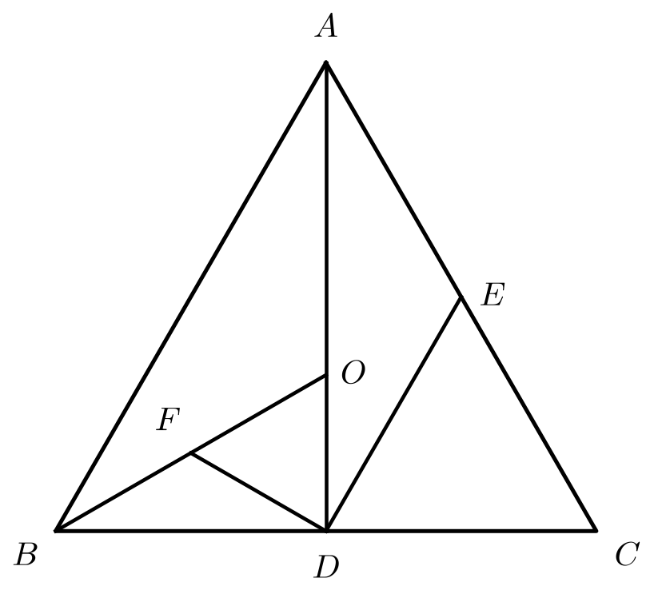

# 11. Тохиромжтой алхмын уртыг сонгох

Энэ параграфаас эхлэн дараагийн дөрвөн параграфт бид математикийн индукцийн аргаар бодлого батлахад хэрэглэгддэг зарим түгээмэл техникийг танилцуулах болно.

::: {.callout-tip icon=false title="Логик бүтэц"}
$P(n)$ нь эерэг бүхэл $n$ тооны тухай өгүүлбэр (эсвэл шинж чанар), $k$ нь өгөгдсөн эерэг бүхэл тоо байг. Дараах нөхцөлүүд биелдэг гэж үзье:

1. $P(1), P(2), \dots, P(k)$ нь үнэн;
2. $P(n)$ үнэн гэдгээс $P(n + k)$ үнэн гэдэг нь мөрдөн гардаг.

Тэгвэл аливаа $n \in \mathbf{N}^*$ хувьд $P(n)$ үнэн байна.
:::

Энд $k$-г **алхмын урт** гэнэ. $k = 1$ үед энэ нь математикийн индукцийн нэгдүгээр хэлбэр болно. Зарим бодлогод илүү том алхмын урт сонгох нь хамаагүй тохиромжтой байдаг.

---

::: {.callout-note icon=false title="Жишээ 1"}
Аливаа эерэг бүхэл $n \geqslant 3$ тооны хувьд $n$ ширхэг эерэг бүхэл тооны кубын нийлбэр хэлбэрээр бичигддэг бүтэн куб тоо оршихыг батал.
:::

**Баталгаа.** Бид энэ бодлогын суурь санааг $x^3 + y^3 = z^3$ тодорхойгүй тэгшитгэлд эерэг бүхэл шийд байхгүй гэдэг үр дүнтэй харьцуулан ойлгож болно.  
$n = 3$ үед $3^3 + 4^3 + 5^3 = 6^3$ тэнцэтгэлээс өгүүлбэр үнэн болохыг харж болно.  
$n = 4$ үед $5^3 + 7^3 + 9^3 + 10^3 = 13^3$ (үүнийг анх Эйлер нээсэн) тэнцэтгэлээс өгүүлбэр үнэн болохыг харна.

Одоо $n$ ($n \geqslant 3$) үед өгүүлбэр үнэн, өөрөөр хэлбэл
$$x_1^3 + x_2^3 + \dots + x_n^3 = y^3$$
нөхцөлийг хангах эерэг бүхэл $x_1 < x_2 < \dots < x_n < y$ тоонууд оршино гэж таамаглая.  
Тэгвэл $6^3 = 3^3 + 4^3 + 5^3$ тэнцэтгэлийг ашиглавал:
$$\begin{aligned} (6y)^3 &= (6x_n)^3 + \dots + (6x_2)^3 + (6x_1)^3 \\ &= (6x_n)^3 + \dots + (6x_2)^3 + (5x_1)^3 + (4x_1)^3 + (3x_1)^3. \end{aligned}$$
Энэ нь $n + 2$ үед өгүүлбэр үнэн болохыг харуулна.  
Тиймээс аливаа $n \geqslant 3$ хувьд өгүүлбэр хүчинтэй.

---

::: {.callout-note icon=false title="Жишээ 2"}
$n$ нь $3$-аас багагүй эерэг бүхэл тоо байг. Аливаа зөв гурвалжныг $n$ ширхэг адил хажуут гурвалжинд хувааж болохыг батал.
:::

**Баталгаа.** $n = 3$ үед зөв $ABC$ гурвалжны төвийг $O$ гэж авбал $\triangle AOB$, $\triangle BOC$, $\triangle COA$ нь бүгд адил хажуут гурвалжнууд болно. Иймд $n = 3$ үед өгүүлбэр үнэн.  
$n = 4$ үед $BC, CA, AB$ талуудын дундаж цэгүүдийг харгалзан $D, E, F$ гэе. Тэгвэл $\triangle AEF$, $\triangle FBD$, $\triangle DCE$, $\triangle DEF$ нь бүгд адил хажуут гурвалжнууд болно. Иймд $n = 4$ үед өгүүлбэр үнэн.

{fig-align="center" width="180px"}

$n = 5$ үед Зураг 6-д харуулсны дагуу зөв $ABC$ гурвалжны төвийг $O$, $BC$ ба $CA$ талуудын дундаж цэгүүдийг харгалзан $D, E$, харин $BO$ хэрчмийн дундаж цэгийг $F$ гэж авъя. Тэгш өнцөгт гурвалжны гипотенузад татсан медиан нь гипотенузын хагастай тэнцүү тул $\triangle ABO$, $\triangle BFD$, $\triangle FOD$, $\triangle DEC$, $\triangle ADE$ нь бүгд адил хажуут гурвалжнууд болно. Иймд $n = 5$ үед өгүүлбэр үнэн.

Одоо аливаа зөв гурвалжныг $n$ ($n \geqslant 3$) ширхэг адил хажуут гурвалжинд хувааж чадна (өөрөөр хэлбэл, $n$ үед өгүүлбэр үнэн) гэж таамаглая. Тэгвэл зөв $ABC$ гурвалжны $BC, CA, AB$ талуудын дундаж цэгүүдийг харгалзан $D, E, F$ гэж аваад зөв $AEF$ гурвалжныг $n$ ширхэг адил хажуут гурвалжинд хуваая. Эдгээр $n$ гурвалжныг $\triangle BDF$, $\triangle CDE$, $\triangle DEF$ гурвалжнуудтай нийлүүлбэл зөв $ABC$ гурвалжныг $n + 3$ ширхэг адил хажуут гурвалжинд хуваасан болно. Иймд $n + 3$ үед өгүүлбэр үнэн.  
Дээрхийг нэгтгэвэл аливаа $n \geqslant 3$ хувьд өгүүлбэр үнэн.

---

::: {.callout-note icon=false title="Жишээ 3"}
Аливаа $n \in \mathbf{N}^*$ хувьд
$$x^2 + y^2 = z^n \tag{1}$$
тодорхойгүй тэгшитгэлд төгсгөлгүй олон эерэг бүхэл шийд оршихыг батал.
:::

**Баталгаа.** $n = 1$ үед дурын $x, y \in \mathbf{N}^*$ хувьд $(x, y, x^2 + y^2)$ нь $(1)$-ийн эерэг бүхэл шийд болно; $n = 2$ үед $m > n \geqslant 1$ ($m, n \in \mathbf{N}^*$) аваад $x = m^2 - n^2$, $y = 2mn$, $z = m^2 + n^2$ гэж тавьбал $x^2 + y^2 = z^2$ болно. Тиймээс $n = 1, 2$ үед өгүүлбэр үнэн.

Одоо $n$ үед өгүүлбэр үнэн гэж таамаглая. Эерэг бүхэл $x, y, z$ тоонуудын хувьд хэрэв $x^2 + y^2 = z^n$ бол $(xz)^2 + (yz)^2 = z^{n+2}$ болно. Иймд $x^2 + y^2 = z^{n+2}$ тодорхойгүй тэгшитгэлд төгсгөлгүй олон эерэг бүхэл шийд оршино. $n = 1, 2$ үед өгүүлбэр үнэн гэдгийг тооцвол аливаа $n \in \mathbf{N}^*$ хувьд өгүүлбэр үнэн.

**Тайлбар.** Энэ бодлогыг мөн дараах аргаар бодож болно: $z = a + b\mathrm{i}$ ($a, b \in \mathbf{N}^*$, $0 < \arg z < \frac{\pi}{n}$; $a^2 + b^2$-ийн утгууд ялгаатай байх ийм $(a, b)$ хосууд төгсгөлгүй олон бий) гэе. Ньютоны биномын теорем ёсоор $z^n = (a + b\mathrm{i})^n = x + y\mathrm{i}$ ($x, y \in \mathbf{Z}$, $xy \neq 0$, учир нь $\arg z^n \in (0, \pi)$) болно. Хоёр талаас модуль авбал $(\sqrt{a^2 + b^2})^n = \sqrt{x^2 + y^2}$ буюу $x^2 + y^2 = (a^2 + b^2)^n$ гарна. Иймд $(\vert{}x\vert{}, \vert{}y\vert{}, a^2 + b^2)$ нь $x^2 + y^2 = z^n$ тэгшитгэлийн эерэг бүхэл шийд болно.

---

::: {.callout-note icon=false title="Жишээ 4"}
Дараах нөхцөлүүдийг хангах $f: \mathbf{N} \to \mathbf{N}$ бүх функцийг ол:

1. Аливаа $m, n \in \mathbf{N}$ хувьд $f(m^2 + n^2) = f(m)^2 + f(n)^2$;
2. $f(1) > 0$.
:::

**Бодолт.** $(1)$-д $m = n = 0$ гэж орлуулбал $f(0) = 2f(0)^2$ болох тул $f(0) = 0$ эсвэл $\frac{1}{2}$ гарна. $f(0) \in \mathbf{N}$ тул $f(0) = 0$. Иймд $(1)$-ээс аливаа $m \in \mathbf{N}$ хувьд $f(m^2) = f(m)^2$ биелнэ.

Эхлээд $n \in \{1, 2, \dots, 10\}$ хувьд $f(n)$-ийн утгыг олъё.  
Нөхцөл болон өмнөх үр дүнгээс $f(1) = f(1^2) = f(1)^2$ болох ба $f(1) > 0$ тул $f(1) = 1$. Цаашилбал:
$$\begin{aligned} f(2) &= f(1^2 + 1^2) = f(1)^2 + f(1)^2 = 1 + 1 = 2; \\ f(4) &= f(2^2) = f(2)^2 = 4; \\ f(5) &= f(2^2 + 1^2) = f(2)^2 + f(1)^2 = 5; \\ f(8) &= f(2^2 + 2^2) = f(2)^2 + f(2)^2 = 8. \end{aligned}$$
Мөн
$$25 = f(5)^2 = f(5^2) = f(3^2 + 4^2) = f(3)^2 + f(4)^2 = f(3)^2 + 16$$
ба $f(3) \in \mathbf{N}$ тул $f(3) = 3$ болно. Тиймээс:
$$\begin{aligned} f(9) &= f(3)^2 = 9, \\ f(10) &= f(3^2 + 1^2) = f(3)^2 + f(1)^2 = 10. \end{aligned}$$
$(1)$ нөхцөл болон $7^2 + 1^2 = 5^2 + 5^2$ гэдгийг ашиглан $f(7) = 7$-г олно. Дараа нь $10^2 = 6^2 + 8^2$ гэдгээс $f(10)^2 = f(6)^2 + f(8)^2$ буюу $f(6) = 6$ гарна.  
Иймд бүх $0 \leqslant n \leqslant 10$ хувьд $f(n) = n$.

Одоо $5$-ын алхамтай индукцээр аливаа $n \in \mathbf{N}$ хувьд $f(n) = n$ болохыг баталъя.  
Үүний тулд дараах адилтгалуудыг ашиглая:
$$\begin{aligned} (5k + 1)^2 + 2^2 &= (4k + 2)^2 + (3k - 1)^2; \\ (5k + 2)^2 + 1^2 &= (4k + 1)^2 + (3k + 2)^2; \\ (5k + 3)^2 + 1^2 &= (4k + 3)^2 + (3k + 1)^2; \\ (5k + 4)^2 + 2^2 &= (4k + 2)^2 + (3k + 4)^2; \\ (5k + 5)^2 &= (4k + 4)^2 + (3k + 3)^2. \end{aligned}$$
$k \geqslant 2$ үед адилтгалуудын баруун талын гишүүн бүр нь зүүн талын эхний гишүүнээс бага байна. Иймд $(1)$ нөхцөл болон индукцийн таамаглал ёсоор адилтгалуудын зүүн талын эхний гишүүн дээрх функцийн утгуудыг тодорхойлж чадна. Өөрөөр хэлбэл, тав таван тоо алгасан индукцлэхэд өгүүлбэр үнэн болно.  
Тиймээс аливаа $n \in \mathbf{N}$ хувьд $f(n) = n$.

**Тайлбар.** Дээрх жишээнээс харахад $k$ алхмын урттай индукцээр $P(n)$-ийг батлах нь үндсэндээ $\{P(n)\}$ өгүүлбэрүүдийг $k$ ширхэг дэд олонлогт хувааж тус бүрд нь батлахтай ижил юм. Мэдээж бид энэ санааг математикийн индукцийн хоёрдугаар хэлбэртэй хослуулан нэг бүлэг өгүүлбэрийг нөгөөг батлахад ашиглаж болно. Дээрх жишээ үүнийг харууллаа.